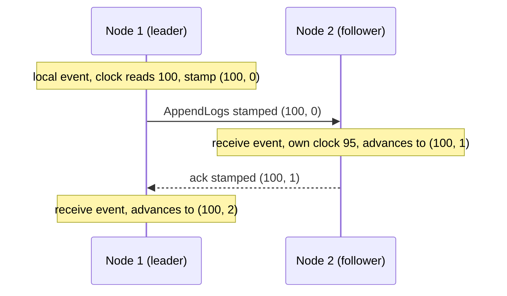
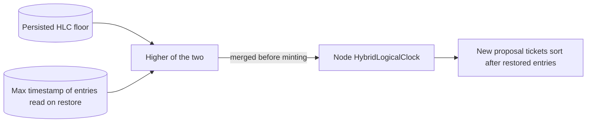

# Hybrid Logical Clocks

Kommander uses hybrid logical clock timestamps as proposal tickets. A hybrid logical clock, or HLC, combines a physical clock reading with a logical counter. The idea comes from the paper [Logical Physical Clocks and Consistent Snapshots in Globally Distributed Databases](https://cse.buffalo.edu/tech-reports/2014-04.pdf).

Machine clocks drift and jump, so a plain wall-clock time cannot order events safely across nodes. A pure logical counter orders events, but it has no link to real time. An HLC does both: it stays close to real time, and it still gives a unique order to events with the same physical time.

Read this page when you use manual commit or rollback, because those calls take the HLC ticket of a proposal. Read it also when you want to know why tickets stay in order after a restart. You do not need to manage the clock. You create a `HybridLogicalClock` for the node, and Kommander advances it.

## Why Not Just Use Wall-Clock Time?

Distributed systems cannot assume every machine has the exact same clock. Even with NTP, clocks can drift, jump, or produce timestamps that are very close together under high write concurrency.

An HLC has three properties that are useful in practice:

- It stays close to physical time, so timestamps remain operationally understandable.
- It includes a logical counter, so events that happen at the same physical time can still be ordered.
- It can advance when a node receives a timestamp from another node, preserving causal ordering across messages.

In this example, Node 2's wall clock reads `95` while Node 1's reads `100`. Timestamps are shown as (physical, logical):



## HLC Shape

Conceptually, an HLC timestamp has three pieces:

| Piece | Purpose |
| --- | --- |
| Physical time | The node's local wall-clock time component. |
| Logical counter | A tie-breaker that advances when physical time is equal or when remote events force the local clock forward. |
| Node id | A final disambiguator used to make timestamps unique across nodes. |

Kommander's `HLCTimestamp` is used as a proposal ticket. It is not the Raft log index, and it does not replace Raft's term or commit rules. It identifies and tracks an in-flight proposal while Raft still decides whether that proposal is committed.

## How Kommander Uses HLCs

`RaftReplicationResult.TicketId` contains the HLC timestamp for a proposal. Use this ticket when manually committing or rolling back a proposal:

```csharp
RaftReplicationResult proposal = await raft.ReplicateLogs(
    partitionId: 1,
    type: "Reservation",
    data: payload,
    autoCommit: false,
    cancellationToken: cancellationToken
);

await raft.CommitLogs(1, proposal.TicketId);
```

The clock is also available directly:

```csharp
HybridLogicalClock clock = new();
HLCTimestamp timestamp = clock.SendOrLocalEvent(nodeId: 1);
```

Use the HLC timestamp as an identifier for Kommander proposal control. Use `RaftReplicationResult.LogIndex` when you need the committed position in the partition log.

## Recovery Floor

Durable WAL adapters persist a per-partition HLC floor. The floor is an upper bound on the physical HLC component of timestamps already written to that partition's log.

On restore, Kommander merges that floor into the local hybrid logical clock before the node can mint new proposal timestamps. It also considers the maximum timestamp from entries read during recovery. This prevents a restart after a wall-clock correction, compaction, or narrowed replay from producing a new proposal ticket that sorts behind entries the WAL already held.



The floor is not a consensus rule and it does not replace Raft terms, log indexes, or commit checks. It is a timestamp hygiene rule for proposal tickets and for consumers that use HLCs as an operational ordering key.

## Further Reading

- [Logical Physical Clocks and Consistent Snapshots in Globally Distributed Databases](https://cse.buffalo.edu/tech-reports/2014-04.pdf), the HLC paper by Kulkarni, Demirbas, Madappa, Avva, and Leone.
- [Logical Physical Clocks PDF mirror](https://cse.buffalo.edu/~demirbas/publications/hlc.pdf), an alternate paper URL from the University at Buffalo.
