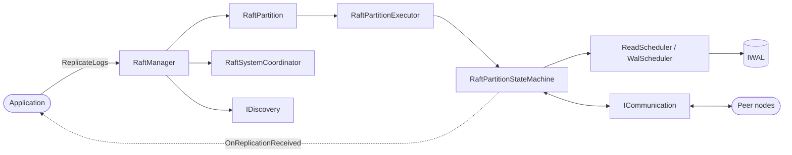
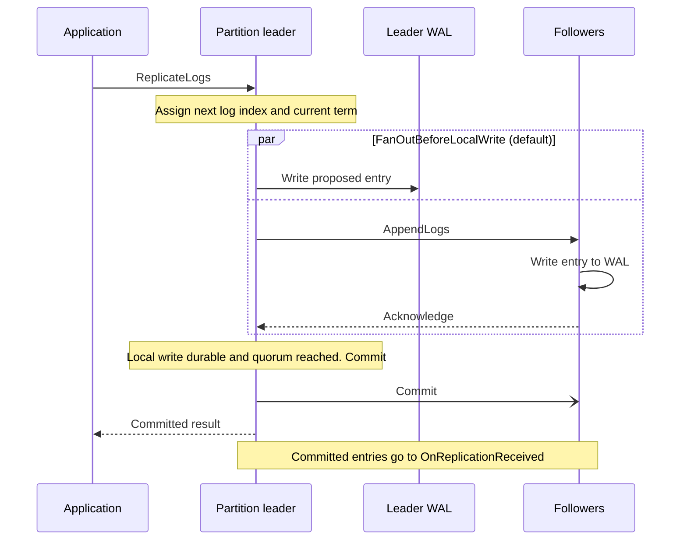
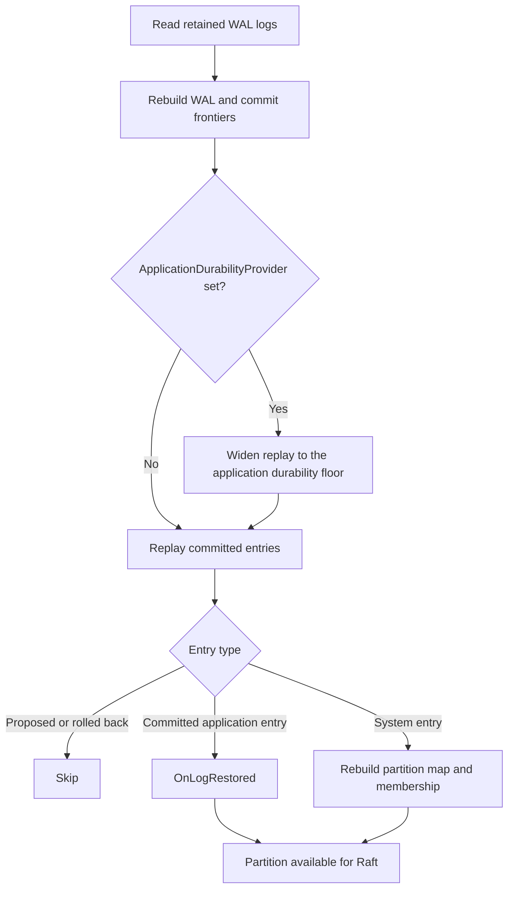

# Architecture Overview

Kommander is an embedded Raft runtime for .NET services.

At a high level, it keeps the same ordered log on several nodes. Your application proposes changes, Kommander replicates those changes through Raft, and every node applies committed entries in the same order.

Kommander is also partitioned: each user partition is its own Raft group with its own leader and log. A node can lead one partition and follow another, which spreads coordination work across the cluster.

```mermaid
flowchart TB
    subgraph N1[Node 1]
        direction TB
        N1S["Partition 0<br/>system"]:::leader
        N1A["Partition 1<br/>leader"]:::leader
        N1B["Partition 2<br/>follower"]
        N1C["Partition 3<br/>follower"]
        N1W[(WAL)]
        N1S ~~~ N1A ~~~ N1B ~~~ N1C ~~~ N1W
    end
    subgraph N2[Node 2]
        direction TB
        N2S["Partition 0<br/>system"]
        N2A["Partition 1<br/>follower"]
        N2B["Partition 2<br/>leader"]:::leader
        N2C["Partition 3<br/>follower"]
        N2W[(WAL)]
        N2S ~~~ N2A ~~~ N2B ~~~ N2C ~~~ N2W
    end
    subgraph N3[Node 3]
        direction TB
        N3S["Partition 0<br/>system"]
        N3A["Partition 1<br/>follower"]
        N3B["Partition 2<br/>follower"]
        N3C["Partition 3<br/>leader"]:::leader
        N3W[(WAL)]
        N3S ~~~ N3A ~~~ N3B ~~~ N3C ~~~ N3W
    end
    N1 <--> N2 <--> N3
    classDef leader fill:#008f63,color:#ffffff,stroke:#04241b
```

Large partition counts are handled with a shared executor pool and hot-set leader checks, so idle partitions do not each require a dedicated thread or high-frequency timer work. See [Partition Scaling](../operations/partition-scaling.md).

By default, every user partition is replicated to every committed voter. When `ReplicationFactor` is set, each user partition can instead record a smaller replica set in the committed partition map. Quorum, elections, and leadership are then scoped to that partition's voter replicas. See [Replica Placement](../guides/replica-placement.md).

## Main Components

| Component | Role |
| --- | --- |
| `RaftManager` | Main `IRaft` implementation. Owns partitions, adapters, schedulers, timers, membership, and lifecycle. |
| `RaftPartition` | Per-partition wrapper around the Raft state machine and executor. |
| `RaftPartitionExecutor` | Serial owner for one partition's operations. Client proposals, transport messages, timers, and WAL completions are processed one at a time. |
| `RaftPartitionStateMachine` | The Raft protocol logic: elections, replication, commit, rollback, backfill, and follower append handling. |
| `RaftSystemCoordinator` | Owns system partition behavior, including partition maps, dynamic membership, splits, merges, and system configuration. |
| `IWAL` | Durable log adapter. Kommander ships RocksDB, SQLite, and in-memory implementations. The external `Solarium.Kommander` project supplies `SolariumWAL`. |
| `ICommunication` | Node-to-node transport. Kommander ships gRPC, REST, and in-memory transports. |
| `IDiscovery` | Bootstrap/contact discovery. With dynamic membership, discovery is not the authority for who can vote. |
| `ReadScheduler` / `WalScheduler` | Fair schedulers that move blocking WAL reads and writes away from the partition execution path. |

## Startup Flow

When a node starts:

1. the application constructs a `RaftManager`
2. `JoinCluster` starts discovery, transport, schedulers, and partitions
3. each partition restores its WAL
4. committed entries are replayed through `OnLogRestored`
5. timers begin
6. leaders are elected per partition.

When dynamic membership is used, a new node joins as a learner first. It catches up before it is promoted to voter, so the existing quorum is not weakened during catch-up.

If a node was evicted while it was restarting or partitioned, it can automatically rejoin when `EnableAutoRejoin` is enabled. The node goes through the same learner catch-up and promotion path as an ordinary join.

## Write Flow

For a normal `ReplicateLogs` call:

1. the application calls the leader for the target partition
2. the leader assigns the next log index and current term
3. the leader writes the proposed entry to its own WAL
4. followers receive `AppendLogs` and write the entry to their WALs
5. the leader commits after quorum acknowledgement
6. committed entries are delivered to `OnReplicationReceived`.

With `autoCommit: true`, the leader commits as soon as quorum is reached. With `autoCommit: false`, the caller uses the returned proposal ticket with `CommitLogs` or `RollbackLogs`.

When a newly elected leader inherits prior-term entries above its local commit frontier, Kommander holds leadership unpublished until an internal promotion barrier commits and the inherited entries have been drained into the application state machine. That prevents a node from advertising itself as leader while its local projection is still behind.

## Restore Flow

The WAL is the durable source of truth after a restart.

During restore:

1. Kommander reads retained logs for the partition
2. the contiguous WAL frontier and committed frontier are reconstructed
3. replay is widened to the application durability floor when `ApplicationDurabilityProvider` is configured
4. proposed and rolled-back entries are ignored for application restore
5. committed application entries are delivered through `OnLogRestored`
6. system entries rebuild the partition map and membership state
7. the partition becomes available for normal Raft operation.

Your application should treat `OnLogRestored` as the path that rebuilds local state from committed history.

## System Partition

Partition `0` is reserved for Kommander system state.

It stores cluster-wide metadata such as:

- the partition map
- replica placement for user partitions
- dynamic membership roster
- split and merge lifecycle records.

Applications may also store small cluster-wide control state on partition `0` under their own log type. The `_RaftSystem` log type is reserved for Kommander. If those application entries are deltas, register `IRaftSystemStateTransfer` so compacted followers can be repaired with a whole-state snapshot.

Application data that belongs to normal workload partitions must use user partitions `1` and above.

The common rule is: anything that affects safety is committed through Raft. Partition ownership and cluster membership are not decided by local discovery snapshots or gossip.

When a follower falls below a compaction floor, snapshot installation runs through the partition's single-writer executor and writes a durable checkpoint boundary before normal backfill resumes.

## Pluggable Layers

Kommander keeps three major layers pluggable:

- storage through `IWAL`
- transport through `ICommunication`
- bootstrap discovery through `IDiscovery`.

That lets the same Raft runtime run in production over durable WALs and network transports, or inside deterministic tests with in-memory adapters.

<ArchDiagram
  group="Kommander node"
  sources={[
    {label: 'Partition 1', icon: 'log'},
    {label: 'Partition 2', icon: 'log'},
    '…',
    {label: 'Partition N', icon: 'log'},
  ]}
  hub={{label: 'RaftManager', icon: 'layers'}}
  targets={[
    {label: 'IWAL', sub: 'RocksDB, SQLite, Solarium, in-memory', icon: 'database'},
    {label: 'ICommunication', sub: 'gRPC, REST, in-memory', icon: 'server'},
    {label: 'IDiscovery', sub: 'Bootstrap contacts', icon: 'chip'},
  ]}
  title="The partitions of a Kommander node run through the RaftManager. The RaftManager uses three pluggable adapters: IWAL for storage, ICommunication for transport, and IDiscovery for bootstrap discovery."
/>

## Related Reading

- [Raft In Kommander](./raft.md)
- [Runtime Internals](../internals/runtime.md)
- [Dynamic Cluster Membership](../guides/dynamic-cluster-membership.md)
- [System Partition State Snapshots](../guides/system-partition-state-snapshots.md)
- [Snapshot Installation](../operations/snapshot-installation.md)
- [Elastic Partitions](../guides/elastic-partitions.md)
- [Log Backfill And Catch-Up](../guides/log-backfill-and-catch-up.md)
- [Partition Quiescence](../guides/partition-quiescence.md)
- [Partition Scaling](../operations/partition-scaling.md)
