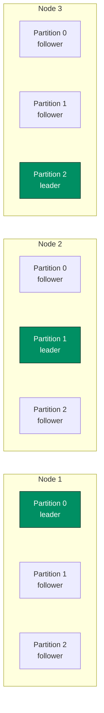
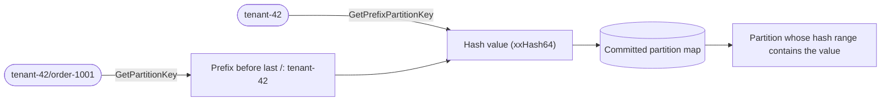

# Partitioning

Kommander uses independent Raft partitions. Partition `0` is reserved for replicated system configuration. Application data must use user partitions with ids greater than `0`; the first user partition is `1`.

Partitions let one cluster manage many independent decision streams. Instead of forcing every update through one leader, Kommander can have different leaders for different partitions. That helps spread work across nodes while keeping strict ordering inside each partition.

For example, with the default full replication on three nodes, each node hosts a replica of every partition, and each partition can have its leader (highlighted) on a different node:



## Routing Keys

Use partition helpers to map application keys to user partitions:

```csharp
int partition = raft.GetPartitionKey("tenant-42/order-1001");
int prefixPartition = raft.GetPrefixPartitionKey("tenant-42");
```

`GetPartitionKey` uses the prefix before the last `/` separator. `GetPrefixPartitionKey` hashes the complete string provided.



Use stable keys. If the same tenant, workflow, or resource is routed with different key formats over time, related decisions may land in different partitions.

Do not call public replication APIs with partition `0`; `RaftManager` rejects userland writes to the system partition. Use partition `1` or higher for application data.

## Dynamic Partitions

Initial user partitions are replicated through the reserved system partition and then started according to the committed partition map. With the default `ReplicationFactor = 0`, every user partition is hosted by every roster voter. When replica placement is enabled, each user partition records the voter replicas that host it.

To split a partition, call `SplitPartitionAsync` on the leader of the source partition:

```csharp
RaftPartitionLifecycleResult split = await raft.SplitPartitionAsync(
    sourcePartitionId: partitionId,
    ct: cancellationToken
);
```

The node must be initialized, the source partition must be `1` or higher, and the local node must lead the source partition. Otherwise, the call throws a `RaftException`.

Kommander exposes create, remove, split, and merge APIs through `IRaft`, along with generation fencing and partition-map snapshots. See [Elastic Partitions](../guides/elastic-partitions.md) for the user-facing lifecycle behavior.

## Replica Placement

Replica placement lets a user partition live on a subset of voters.

Set `ReplicationFactor` to a positive value to target that many voter replicas per user partition. A range with RF 3 commits through a majority of its three voter replicas, regardless of how many voters exist in the whole cluster.

Partition `0` remains fully replicated because it stores the authoritative system state, including the partition map and replica assignments.

See [Replica Placement](../guides/replica-placement.md) for routing, rebalancing, and configuration details.
