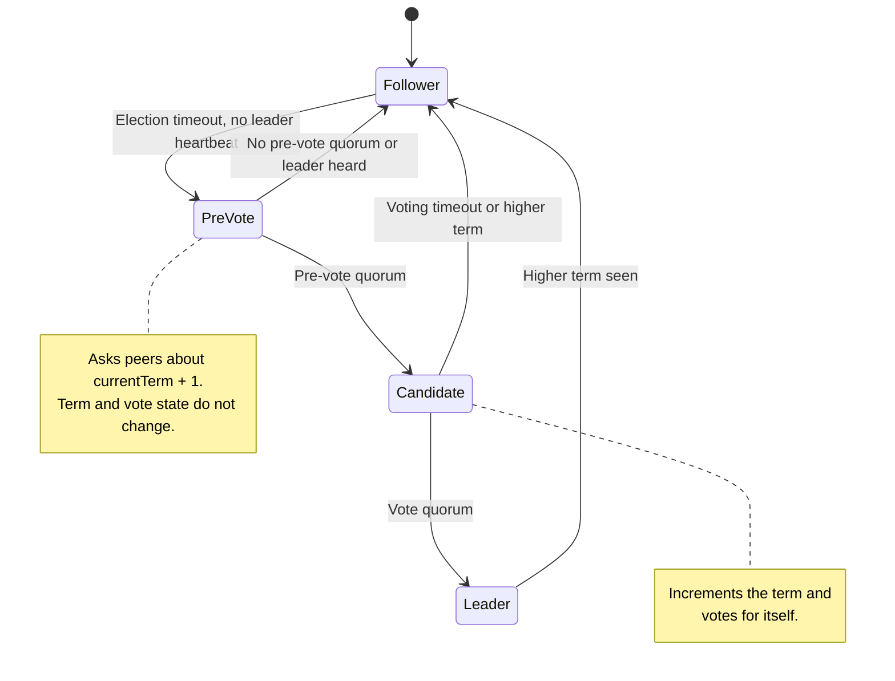
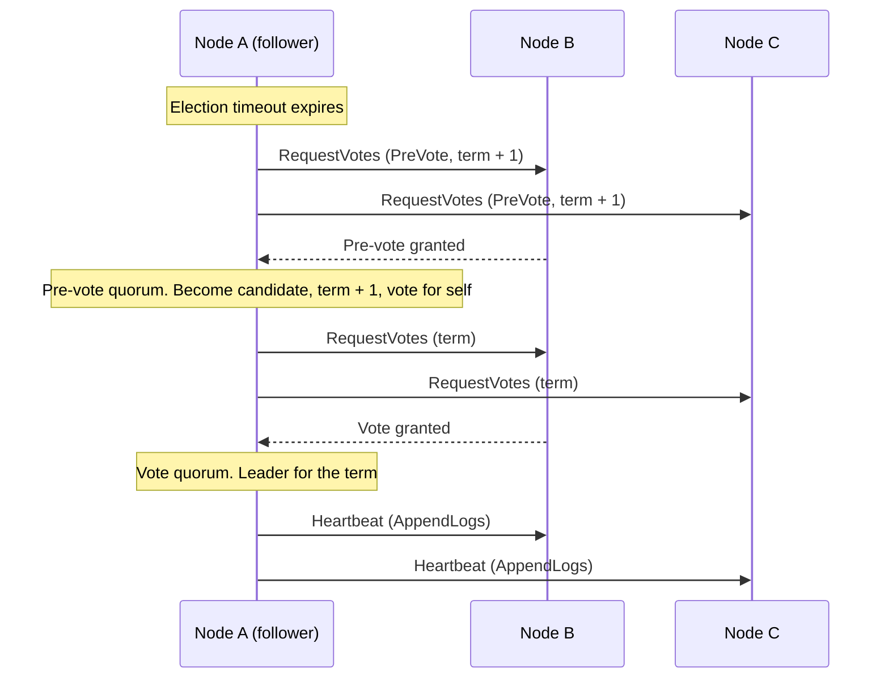
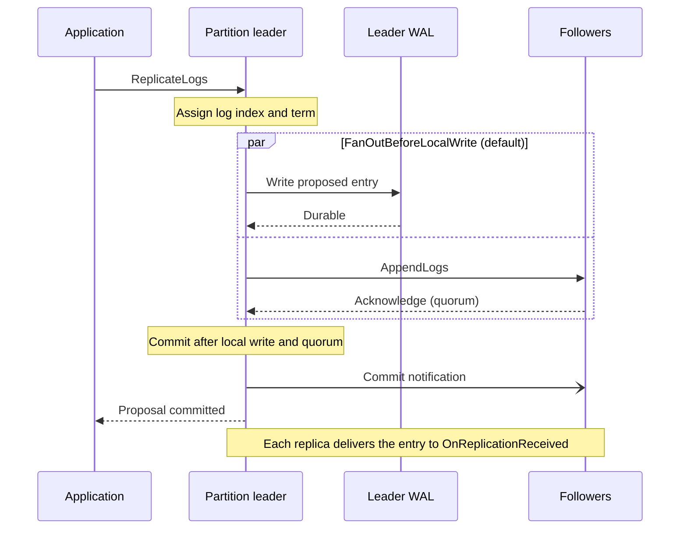

# Raft In Kommander

[Raft](https://raft.github.io/) is a consensus protocol that helps a cluster maintain a replicated state machine by synchronizing a durable log. A leader receives proposed changes, writes them locally, replicates them to followers, and commits them after a quorum acknowledges the proposal.

Kommander implements this model with partitioned Raft groups. Each partition elects its own leader, so a node can lead one partition and follow another. This improves throughput when workloads can be routed by key while preserving strict ordering inside each partition.

If you are new to Raft, read "replicated state machine" as "the same sequence of decisions is replayed on every replica that hosts the partition." With default full replication, that means every voter. With replica placement enabled, it means the partition's assigned replicas. Your code turns that sequence into useful state.

<ReplicaRing
  center="Partition P (Raft group)"
  client="Application"
  nodes={['Node 1', 'Node 2', 'Node 3']}
  title="An application proposes changes to Node 1, the leader of the Raft group for partition P. The leader replicates each log entry to the followers Node 2 and Node 3."
/>

## Why Raft Exists

Raft solves a specific problem: several machines need to agree on what happened, in what order, even when some machines are slow, disconnected, or restarted.

Without a consensus protocol, two nodes can both believe they are allowed to make the next decision. That can create conflicting state. Raft avoids this by electing one leader per partition and requiring a majority of nodes to accept each committed entry.

## Leader Election

Followers monitor leader heartbeats. When a heartbeat is not received within the configured election window, a follower does not jump straight into a real election anymore.

Kommander first runs a pre-vote round. In that round, the follower asks peers whether they would support an election for `currentTerm + 1` without actually incrementing the term or recording a real vote yet. Only if that pre-vote reaches quorum does the node become a candidate, increment the term, and request real votes.

This reduces disruption from stale or partitioned nodes. A node that is isolated, behind on logs, or cut off from quorum can fail pre-vote without forcing the rest of the cluster into unnecessary term churn.

The messages of one successful election look like this:

A term is an election era. When a new election happens, the term increases. Terms help nodes reject stale messages from old leaders.

## Log Replication

The partition leader accepts proposals, assigns log indexes, writes the proposal to its WAL, and sends append-log requests to followers. Once quorum acknowledges the proposal, the leader can commit it and notify followers.

The log index is the committed position of an entry in the partition's ordered history. If two nodes have committed entry `25`, they should agree on the earlier committed entries that led there.

Followers that fall behind are repaired through bounded log backfill. The live replication path handles followers that are keeping up; the backfill path sends missing committed entries with a log-matching anchor so a follower cannot grow gaps or keep a divergent uncommitted tail. See [Log Backfill And Catch-Up](../guides/log-backfill-and-catch-up.md).

## Safety Details Kommander Handles

Several edge cases are handled inside the Raft runtime so application code can stay focused on applying committed commands:

- Higher-term votes and append acknowledgements fence old leaders quickly, so a node that learns about a newer term steps down instead of continuing to publish stale leadership.
- Pipelined commits are applied in log order on the leader, even when a later proposal reaches quorum before an earlier one.
- Prior-term entries inherited by a newly elected leader are drained through the promotion barrier before leadership is published to applications.
- Unresolved proposed WAL entries are retried or repaired through the Raft/backfill path instead of leaving followers with holes.
- The hybrid logical clock allocates unique proposal timestamps under concurrent callers, preserving a stable ordering key for tickets and diagnostics.

## Idle Partitions

When partition quiescence is enabled, an idle partition can stop sending per-partition heartbeats after `QuiesceAfter`. The leader sends a quiesce marker, followers stay quiet while SWIM reports the leader node as alive, and any real write wakes the partition. See [Partition Quiescence](../guides/partition-quiescence.md).

## State Machine Integration

Kommander does not own your domain state. Your application applies committed log entries through `OnReplicationReceived` and rebuilds state during restore through `OnLogRestored`.

## Runtime Model

Current Kommander releases use explicit partition executors instead of an actor runtime. Each partition has a serial execution boundary that owns its Raft state. Timer, transport, client, and WAL-completion work is converted into partition operations and processed in order by that partition owner.

Synchronous RocksDB and SQLite work is moved behind fair schedulers. `ReadScheduler` handles partition-tagged WAL reads, and `WalScheduler` handles partition-tagged WAL writes. This keeps blocking storage calls off the partition execution path while preserving per-partition ordering and fairness across partitions.

## Raft Literature

Start with these primary resources:

- [The Raft website](https://raft.github.io/) collects the paper, visualizations, talks, implementations, and related material.
- [In Search of an Understandable Consensus Algorithm](https://raft.github.io/raft.pdf) is the original Raft paper by Diego Ongaro and John Ousterhout.
- [The USENIX ATC 2014 paper page](https://www.usenix.org/conference/atc14/technical-sessions/presentation/ongaro) includes the publication metadata and conference context.
- [Raft Refloated: Do We Have Consensus?](https://www.cl.cam.ac.uk/~ms705/pub/papers/2015-osr-raft.pdf) is a useful critical analysis of the Raft specification and its understandability claims.

For implementation context, read production libraries after the paper:

- [etcd-io/raft](https://github.com/etcd-io/raft) is a widely used Go Raft library.
- [HashiCorp Raft](https://github.com/hashicorp/raft) is another widely used library implementation.
- [Consul's consensus documentation](https://developer.hashicorp.com/consul/docs/concept/consensus) explains how a production system applies Raft operationally.
