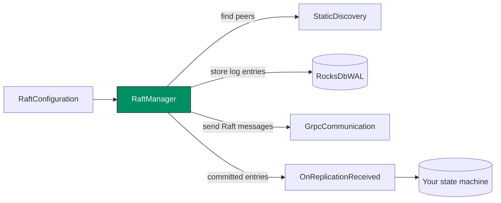
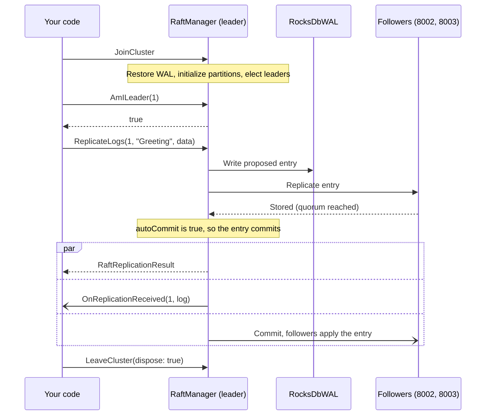

# Getting Started

This page takes you from an empty project to a node that joins a cluster and replicates one command. At the end, you know the parts that every Kommander node needs, and where your own code connects to them. Use it to check your setup. Then continue to the guides to design a real service.

:::tip Ready for a complete application?
If you already understand the minimal setup and want to go deeper, jump to [Advanced Tutorial: Build A Replicated Key/Value Service](guides/advanced-replicated-simpledb.md). It covers a three-node service, partition routing, leader redirects, durable application state, recovery, and failure testing.
:::

Install Kommander from NuGet:

```shell
dotnet add package Kommander
```

Or with the NuGet Package Manager Console:

```powershell
Install-Package Kommander
```

## Minimal Node

This example creates one node using static discovery, RocksDB storage, and gRPC communication. In a real cluster, run one `RaftManager` per node with a unique host, port, node id, and a discovery list containing the other nodes.

This sample does not build a database by itself. It shows the minimum pieces needed to join a Raft cluster and replicate one application command. The command is just bytes plus a string `type`; your service decides how to decode and apply it.

Before reading the code, keep these roles in mind:

- `RaftConfiguration` names this node and tells other nodes how to reach it.
- `StaticDiscovery` lists the peer nodes in the cluster.
- `RocksDbWAL` stores Raft log entries durably.
- `GrpcCommunication` sends Raft messages to other nodes.
- `OnReplicationReceived` is where your application applies committed entries.



```csharp
using System.Text;
using Kommander;
using Kommander.Communication.Grpc;
using Kommander.Data;
using Kommander.Discovery;
using Kommander.Time;
using Kommander.WAL;
using Microsoft.Extensions.Logging;

ILoggerFactory loggerFactory = LoggerFactory.Create(builder => builder.AddConsole());
ILogger<IRaft> logger = loggerFactory.CreateLogger<IRaft>();

// Every node needs a stable identity and an advertised endpoint.
// Partition 0 is reserved for Kommander internals. Application data uses
// partitions greater than 0, starting with partition 1.
RaftConfiguration configuration = new()
{
    NodeName = "node-1",
    NodeId = 1,
    Host = "localhost",
    Port = 8001,
    InitialPartitions = 8
};

IRaft raft = new RaftManager(
    configuration,
    // StaticDiscovery is the simplest cluster membership option: list the peers
    // this node should contact. Do not include the local node in this list.
    new StaticDiscovery([
        new RaftNode("localhost:8002"),
        new RaftNode("localhost:8003")
    ]),
    // The WAL stores Raft log entries before they are applied to your state
    // machine, so proposed and committed work can be restored after a restart.
    new RocksDbWAL(path: "./data", revision: "node-1", logger),
    // The communication adapter must match the endpoints exposed by your host.
    // For gRPC, map the routes shown in the Hosting Endpoints guide.
    new GrpcCommunication(),
    // Proposal tickets use hybrid logical clock timestamps for causal ordering.
    new HybridLogicalClock(),
    logger
);

// This is where your application applies committed replicated entries.
// In a real service, decode log.LogData and update your own state machine.
raft.OnReplicationReceived += (partitionId, log) =>
{
    string payload = Encoding.UTF8.GetString(log.LogData ?? []);
    Console.WriteLine($"{partitionId}: {log.Id} {log.Type} {log.LogType} {payload}");
    return Task.FromResult(true);
};

// Join starts discovery, restores WAL state, initializes partitions, and begins
// leader election and heartbeat processing.
using CancellationTokenSource joinTimeout = new(TimeSpan.FromSeconds(30));
await raft.JoinCluster(joinTimeout.Token);

using CancellationTokenSource timeout = new(TimeSpan.FromSeconds(10));

// Only the leader for a partition can accept new proposals for that partition.
if (await raft.AmILeader(1, timeout.Token))
{
    // ReplicateLogs writes the payload to the leader WAL, sends it to followers,
    // and auto-commits after quorum because autoCommit defaults to true.
    RaftReplicationResult result = await raft.ReplicateLogs(
        1,
        "Greeting",
        Encoding.UTF8.GetBytes("Hello from Kommander"),
        cancellationToken: timeout.Token
    );

    Console.WriteLine(result.Success
        ? $"Committed log #{result.LogIndex}"
        : $"Replication failed: {result.Status}");
}

// LeaveCluster stops timers, partition executors, transport dispatch, and
// fair WAL schedulers. Passing dispose also disposes owned resources.
await raft.LeaveCluster(dispose: true);
```

When this node is the leader for partition `1`, the sample runs this sequence:



If this node is not the leader for partition `1`, the sample does not replicate anything. In a real service, you can call `WaitForLeader` to find the leader endpoint and route the client request there, or let clients retry against another node.

If you omit the `JoinCluster` cancellation token, Kommander still applies an internal 60-second timeout while waiting for cluster initialization.

## Next Steps

- Create and configure a node in [Creating A Node](guides/creating-a-node.md).
- Replicate proposals in [Replicating Logs](guides/replicating-logs.md).
- Expose transport routes in [Hosting Endpoints](guides/hosting-endpoints.md).
- Build a complete three-node service in [Advanced Tutorial: Replicated SimpleDB](guides/advanced-replicated-simpledb.md).
