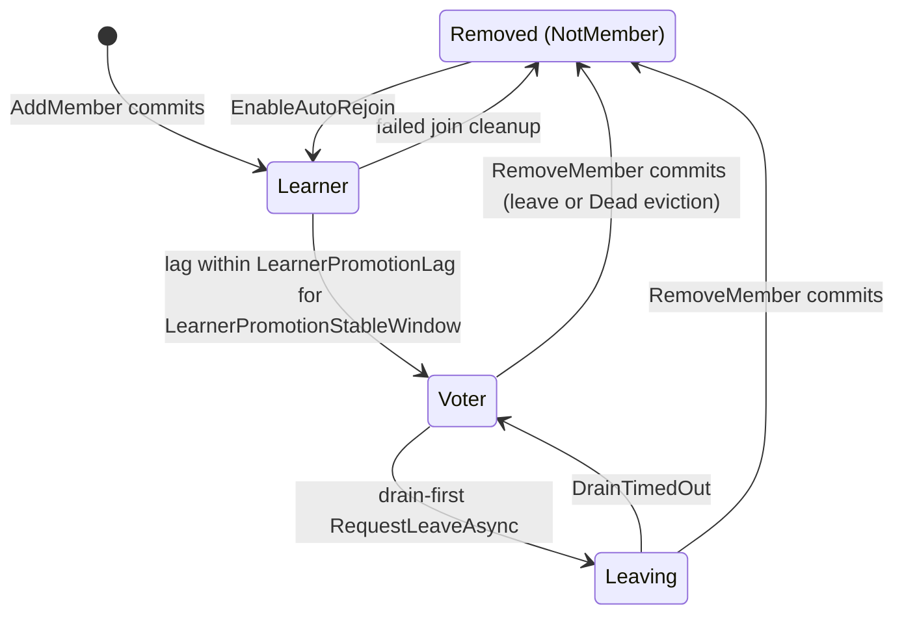
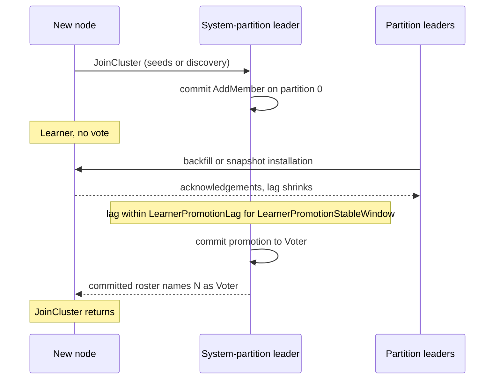
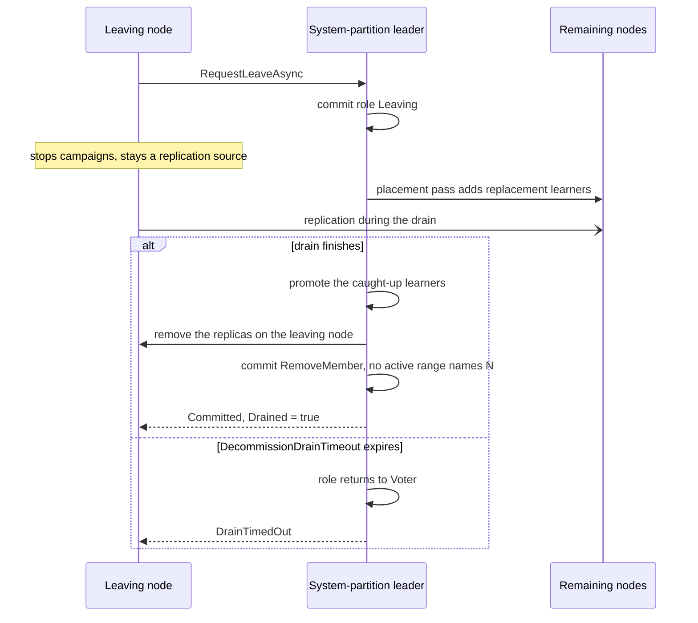

# Dynamic Cluster Membership

Use dynamic membership to grow, shrink, or repair a cluster while it runs. You can add a node for more capacity, remove a node for maintenance, or replace a node that failed. The other nodes keep running, and the quorum stays safe during each change.

Membership changes are always available. You do not enable them. A new node calls `JoinCluster` with seed endpoints or with discovery. A node that leaves calls `LeaveCluster` or `RequestLeaveAsync`. Kommander does the rest:

- A new node starts as a non-voting learner. It does not count toward the quorum.
- The learner receives the data that it is missing and catches up.
- The leader promotes the learner to a voter after its lag stays small.
- A node can leave gracefully. Kommander commits its removal from the roster.
- Kommander evicts a node that stays dead. The failure detector is on by default, and all the built-in transports support it. The system-partition leader removes a `Dead` member after `DeadMemberEvictionGrace` (default 2 minutes).

Read this page before you add or remove nodes in production, or when a new node stays a learner. This page gives the behavior that a user can see.

## The Core Idea

Kommander keeps one authoritative cluster roster on the system partition, partition `0`.

That roster is a committed Raft record. It is not a discovery snapshot. It is not gossip state. Gossip is the exchange of membership messages between nodes.

The practical results are:

- Kommander computes the quorum from the committed roster.
- A learner does not count toward the quorum.
- Discovery helps a node find the contact points. It does not define the live membership.
- Gossip can spread the roster faster. It does not decide the nodes that can vote.
- Kommander rejects an append-log RPC or a snapshot RPC from an endpoint outside the committed roster. The one exception is an endpoint that is already the accepted leader of that term.

Remember one thing above all: the membership truth comes from Raft. It does not come from discovery or gossip.

## Member Roles

Each member has one of these roles:

- `Learner`: The member receives the replication. It does not vote. It cannot win an election.
- `Voter`: The member counts toward the quorum. It takes a full part in the elections.
- `Leaving`: This is a committed decommission state for a drain-first leave. The node stops its campaigns. It stays in the peer lists, so the evacuation can catch up from it. It can return to `Voter` if the drain cannot finish.
- `NotMember`: `LocalRole` returns this role locally when the committed roster does not contain the node.

The typical lifecycle is:



## Public API

`IRaft` gives the primary membership methods:

```csharp
ClusterMembership roster = raft.GetMembership();
ClusterMemberRole role = raft.LocalRole;

raft.OnMembershipChanged += membership =>
{
    Console.WriteLine($"Roster version: {membership.MembershipVersion}");
};
```

`ClusterMembership` contains:

- `MembershipVersion`
- `Members`

Each `ClusterMember` contains:

- `Endpoint`
- `NodeId`
- `Role`
- `JoinedVersion`

`MembershipVersion` is the monotonic version of the roster. Each committed add, promote, or remove increments it.

## Watch The Membership Changes

Use `OnMembershipChanged` when your application must observe the roster changes. This is useful for logs, metrics, dashboards, or automation.

```csharp
raft.OnMembershipChanged += membership =>
{
    foreach (ClusterMember member in membership.Members)
        Console.WriteLine($"{member.Endpoint} -> {member.Role}");
};
```

The important behavior is:

- The callback receives a snapshot of the full roster.
- It fires when this node advances to a newer committed membership version.
- Each handler must stay fast. It must not block the loop of the system coordinator.

## Join A Cluster

You can join through discovery. You can also join through explicit seed endpoints.

A join with seeds:

```csharp
using CancellationTokenSource joinTimeout = new(TimeSpan.FromSeconds(30));

await raft.JoinCluster(
    seeds: ["node-a:7000", "node-b:7000", "node-c:7000"],
    cancellationToken: joinTimeout.Token
);
```

A join with discovery:

```csharp
using CancellationTokenSource joinTimeout = new(TimeSpan.FromSeconds(30));

await raft.JoinCluster(joinTimeout.Token);
```

The sequence is:

1. The existing cluster commits `AddMember` for the new endpoint.
2. The new node enters as a `Learner`.
3. The leader replicates the state to it.
4. The leader promotes it to `Voter` after its catch-up stays sufficient.



`JoinCluster(...)` does not return when the cluster only knows the node. It waits for the node to become a committed voter.

Two configuration deadlines cover different failure modes:

| Property | Default | Description |
| --- | ---: | --- |
| `JoinTimeout` | `60 s` | Bounds seed admission and the initial partition-map assembly. |
| `JoinPromotionStallTimeout` | `5 min` | Bounds how long a learner may show no catch-up progress while it waits for promotion. |

Promotion is deliberately progress-aware. Catching up a node can take longer than a fixed deadline when it needs a large snapshot, but the join continues while a partition frontier advances, a partition appears, snapshot chunks arrive, or an install starts or progresses. A caller cancellation token still stops any phase earlier.

If a seed join fails after the cluster admitted the learner, Kommander asks the system-partition leader to remove it before throwing. This prevents a failed join from leaving a permanently stalled learner in the committed roster. If that cleanup cannot be acknowledged, Kommander logs a warning and an operator should inspect the roster.

## Graceful Leave And Decommission

A node can leave with this call:

```csharp
await raft.LeaveCluster(dispose: true);
```

`LeaveCluster` is the helper for a shutdown. Its behavior is:

1. The node marks itself `Leaving`.
2. It stops its campaigns immediately.
3. The cluster commits `RemoveMember(self)` on partition `0`.
4. The node shuts down.

The node can be the system-partition leader. It then removes itself under the old quorum. After that, it steps down.

For a controlled decommission, use `RequestLeaveAsync` first:

```csharp
LeaveClusterResult result = await raft.RequestLeaveAsync(cancellationToken);

if (result.Left)
    await raft.LeaveCluster(dispose: true, cancellationToken);
```

`RequestLeaveAsync` asks the cluster to remove the local node from the committed roster. It does not stop the node. An operator or a host service can then examine the result before the end of the process.

`RequestLeaveAsync` uses a drain-first decommission in one case. That case is an active replica placement with the leaving node in the committed partition map:

1. The cluster commits the member role as `Leaving`.
2. The placement passes add replacement replicas on the nodes that stay.
3. The learners catch up. The cluster promotes them.
4. Kommander removes the replicas on the leaving node.
5. The final `RemoveMember` commits when no active range names the leaving node.



This sequence keeps the durability of each partition during a planned removal. The leaving node stays available as a replication source during the drain. Kommander stops its campaigns while its committed role is `Leaving`.

The important results are:

- `Committed`: Kommander removed the node from the roster.
- `NotAMember`: The roster did not contain the node.
- `RefusedInsufficientVoters`: The removal leaves the cluster with no voter.
- `RefusedDrainInProgress`: Another member drains now. Retry after that drain ends.
- `NotInitialized`: The local node has no committed roster to leave yet.
- `NoLeader`: Kommander could not resolve the system-partition leader.
- `Timeout`: The cancellation token or the deadline of the caller bounded the request.
- `DrainTimedOut`: The evacuation did not finish before `DecommissionDrainTimeout`. The role returned to `Voter`.
- `Evicted`: SWIM evicted the node while the decommission was in progress. The replicas were not fully evacuated, so the node must not be stopped as if the decommission completed.

`LeaveClusterResult.Left` is true for `Committed` and for `NotAMember`. It is false for `Evicted`. `LeaveClusterResult.Drained` tells you if the evacuation moved every replica that named the node before the removal. After a refused request or a failed request, the node stays a normal participant, or it becomes one again. After a committed removal, it stops its campaigns. Shut it down, or restart it through the normal join path.

An eviction and a requested removal look identical in the member list because the endpoint is absent in both cases. Kommander now records the reason in the committed roster's bounded `Departures` history. A removal requested by the node remains final. An eviction voids the decommission attempt: the request returns `Evicted`, the leave suppression is released, and `EnableAutoRejoin` can admit the still-running node as a learner before promoting it to voter again. Retry the decommission only after the node has rejoined.

When a timed-out drain is confirmed rolled back to `Voter`, Kommander also releases the leave suppression state. The node can campaign normally and, if it is evicted later for an unrelated failure, `EnableAutoRejoin` works as it does for any other voter. If rollback cannot be confirmed, the suppression remains because the original removal can still finish; the warning in that path requires operator attention.

Only one member can be `Leaving` at a time. Do not use RF 1 for a planned decommission workflow. A range can have the leaving node as its only voter. That range cannot drain safely after a loss of leadership during the drain.

## Automatic Promotion

The promotion from a learner to a voter is automatic.

The leader promotes a learner after two conditions. The learner must stay sufficiently close to the committed log. It must hold that position for a sufficient time. These settings control the conditions:

- `LearnerPromotionLag`
- `LearnerPromotionStableWindow`

Therefore, a node can join without harm to the quorum availability during its catch-up.

Replica placement also logs a warning when an added learner remains not promotable for `LearnerPromotionStallWarningAfter`, which defaults to 30 seconds. The message identifies the last failed check, such as a missing leader hint, an unanswered probe, a missing follower frontier, or excessive lag. This threshold is diagnostic only and does not force or cancel promotion.

## Catch-Up And Snapshot Repair

Kommander uses bounded log backfill for the catch-up of a learner. Backfill is the transfer of missing committed log entries from the leader.

Backfill works while the learner needs entries above the current compaction floor. The WAL can already compact the history that a learner needs. The WAL is the write-ahead log. The leader then changes to snapshot installation. This needs the relevant application transfer hook.

In practical terms:

- A learner catches up from the retained committed log history first.
- `IRaftSystemStateTransfer` can repair the application deltas on partition `0`.
- `IRaftPartitionStateTransfer` repairs the whole state of a user partition. It is the preferred hook for the catch-up of a learner.
- `IRaftStateMachineTransfer` moves a key range during a split or a merge. For catch-up, Kommander uses it only when `IRaftPartitionStateTransfer` is not registered.
- A heavily compacted cluster can still block a promotion when the necessary transfer hook is missing.
- A join timeout can mean two things. The learner could not catch up from the retained WAL. The learner could not install a snapshot.

See [Log Backfill And Catch-Up](./log-backfill-and-catch-up.md) for the ordinary catch-up of a follower. See [Snapshot Installation](../operations/snapshot-installation.md) for the repair path below the floor.

## Failure Detection And Eviction

Kommander also has a failure detector in the SWIM style:

- a direct ping
- an indirect ping through the peers
- the `Suspect` state
- then the `Dead` state
- then an eviction by the system-partition leader.

For the full liveness model, see [SWIM Failure Detection](./swim-failure-detection.md).

Kommander enables SWIM by default. `PingInterval` defaults to `1 second`.

Set `PingInterval` to `0` or lower only when you want no failure detection. Then also set `EnableQuiescence = false`. A quiesced partition depends on SWIM to detect a dead leader node.

## Transport Support

The transport support is:

- The roster commits and the join flow work on `InMemory`, gRPC, and REST.
- The RPCs for a graceful leave work on `InMemory`, gRPC, and REST.
- The cross-partition remote lag checks for a learner promotion work on `InMemory`, gRPC, and REST.
- The snapshot installation works on `InMemory`, gRPC, and REST.
- The direct SWIM probe and the indirect SWIM probe work on `InMemory`, gRPC, and REST.
- The gossip anti-entropy works on `InMemory`, gRPC, and REST.

For a gRPC cluster and a REST cluster today, this means:

- A join works.
- A graceful leave works through the transport RPC path.
- A learner promotion can use remote checks of the follower lag. It does not depend on local observations only.
- A repair below the floor can use the snapshot install RPC. This needs the relevant transfer hook.
- The committed membership changes still replicate through Raft.
- The SWIM failure detection works through the transport.
- The roster convergence through gossip works through the transport. The load reports of the leader balancer also work.

## Important Status Values

A membership operation can give these relevant statuses:

- `Success`
- `StaleMembership`
- `ConcurrentMembershipChange`
- `InsufficientVoters`

Interpret them in this way:

- `StaleMembership`: The roster changed after the computation of the operation. Read the membership again. Then retry.
- `ConcurrentMembershipChange`: Another membership change is in flight. Retry after it commits.
- `InsufficientVoters`: The removal makes the cluster unavailable. Do not retry without an examination.

## Eviction Races And Auto-Rejoin

The eviction of a dead member is conservative on purpose.

`DeadMemberEvictionGrace` defaults to `2 minutes`. A member can stay `Dead` after that grace period. The system-partition leader then makes one final direct probe before it commits `RemoveMember`. If the endpoint responds, Kommander marks it alive. It then skips the eviction in that pass.

This prevents the eviction of a node that entered the `Dead` state for a short time during a slow restart. That node becomes reachable again before the commit of the removal.

A node that runs can find that Kommander removed it from the committed roster. With `EnableAutoRejoin = true`, the node runs the join flow again automatically. It enters as a learner. It returns to the voter role after a normal catch-up. Kommander suppresses the auto-rejoin during a requested graceful leave and before the first successful join of the node. If SWIM evicts the node while `RequestLeaveAsync` is active, the committed `Evicted` departure reason cancels that suppression because the requested drain did not complete.

Disable the auto-rejoin only for one operational model. In that model, you remove a live node remotely on purpose. You expect that process to stay outside the cluster while it runs.

## Configuration Settings

The primary settings for the membership are:

- `BackfillThreshold`
- `BackfillEnabled`
- `FollowerSaturationBackoff`
- `MaxBackfillEntriesPerRound`
- `JoinTimeout`
- `JoinPromotionStallTimeout`
- `LearnerPromotionLag`
- `LearnerPromotionStableWindow`
- `LearnerPromotionStallWarningAfter`
- `GossipInterval`
- `GossipFanout`
- `PingInterval`
- `PingTimeout`
- `IndirectPingFanout`
- `SuspicionTimeout`
- `DeadMemberEvictionGrace`
- `EnableAutoRejoin`
- `DecommissionDrainTimeout`
- `PlacementPassInterval`
- `EnableQuiescence`
- `QuiesceAfter`

See [Configuration](../reference/configuration.md) for the defaults and the operational notes.

## Practical Advice

- Use discovery to find the contact points. It is not the source of truth for the nodes that can vote.
- Connect `OnMembershipChanged` to your logs or your metrics. Every roster change is then observable.
- Keep `EnableQuiescence = false` if you disable SWIM with `PingInterval = 0`.
- A learner can stay a learner. Examine the catch-up behavior and the compaction behavior first. Do not assume that the elections are broken.
- Partition `0` is reserved for the system state of Kommander. The membership changes commit there. They do not commit through a user partition.

## Related Reading

- [Creating A Node](./creating-a-node.md)
- [SWIM Failure Detection](./swim-failure-detection.md)
- [Partition Quiescence](./partition-quiescence.md)
- [Configuration](../reference/configuration.md)
- [IRaft API](../reference/iraft-api.md)
- [Adapters](../reference/adapters.md)
