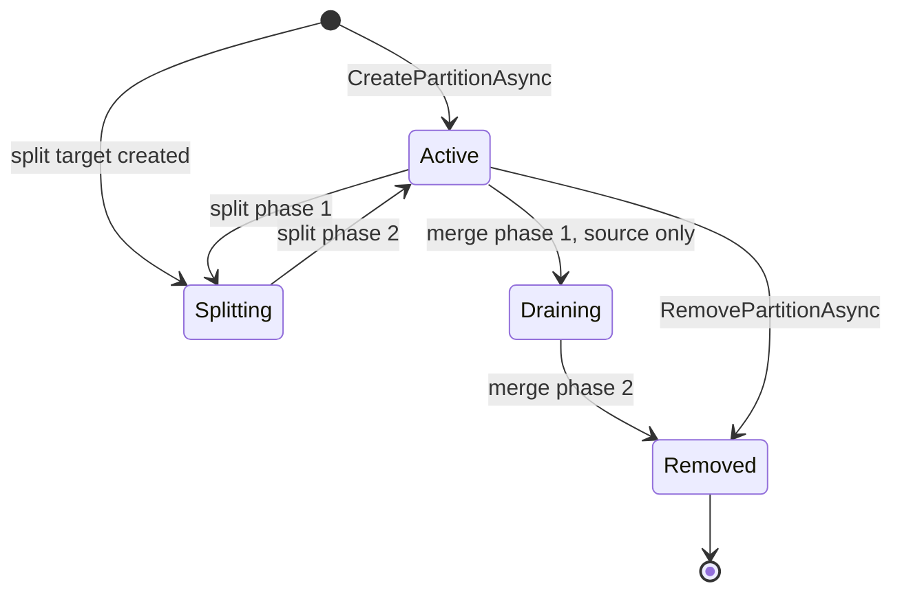
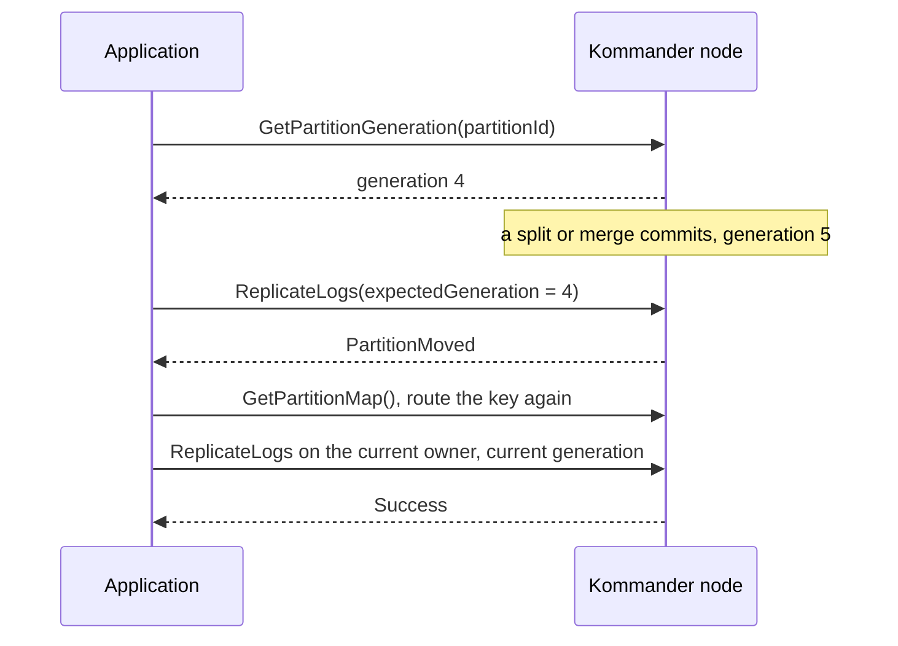
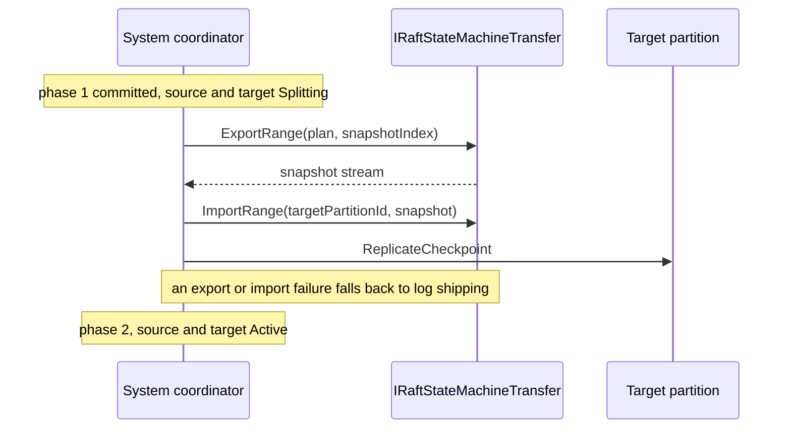

# Elastic Partitions

Elastic partitions let you change the partition layout while the cluster runs. You do not need to know the correct partition count in advance. When one key range gets too hot, you split it. When two ranges go quiet, you merge them.

An application can do these operations:

- create a new partition, for example when a new workload segment needs its own partition
- split a hot partition into two partitions, when one tenant or key range becomes much hotter than the others
- merge two partitions that are mostly idle
- remove a partition that it no longer needs, such as an unrouted partition that the application manages.

Kommander never changes the layout on its own. Your application decides when to act and calls the APIs. [Partition Load Signals](./partition-load-signals.md) help you decide.

This page gives the APIs for the user. It also gives the application behavior that you must plan for, such as the routing changes and the transfer of state during a split.

Partition `0` stays reserved for the system configuration of Kommander. The elastic partition APIs apply to user partition `1` and above.

Read these pages if you want a task-oriented procedure instead of the full API:

- [Splitting A Hot Partition](./splitting-a-hot-partition.md)
- [Merging Idle Partitions](./merging-idle-partitions.md)

## Routing Modes

Each partition in the map uses one of two routing modes:

- `HashRange`
- `Unrouted`

### HashRange

A `HashRange` partition takes part in the normal key-based routing.

These methods return it:

- `GetPartitionKey`
- `GetPrefixPartitionKey`

Use this mode when the application wants Kommander to route the keys automatically.

`GetPartitionKey` and `GetPrefixPartitionKey` behave differently:

- `GetPartitionKey("tenant-42/order-1001")` hashes the prefix before the last `/`. Therefore, the effective routing key is `tenant-42`.
- `GetPrefixPartitionKey("tenant-42/order-1001")` hashes the full string exactly as you give it.

Therefore, `GetPartitionKey` is useful when related records must stay together under a shared prefix. `GetPrefixPartitionKey` is useful when the full key must decide the placement.

Examples:

```csharp
int tenantPartition = raft.GetPartitionKey("tenant-42/order-1001");
int exactKeyPartition = raft.GetPrefixPartitionKey("tenant-42/order-1001");
```

In the first call, all the keys with the `tenant-42` prefix before the last slash go to the same partition. In the second call, two different full keys can go to different partitions. This occurs even with the same prefix.

### Unrouted

An `Unrouted` partition is in the partition map. The hash-based routing helpers never return it.

Use this mode when the application addresses a partition directly by its id. That application does not route through a hash key.

## Primary APIs

`IRaft` gives the elastic partition methods.

### Create A Partition

```csharp
RaftPartitionLifecycleResult created = await raft.CreatePartitionAsync(
    partitionId: 10,
    mode: RaftRoutingMode.Unrouted,
    ct: cancellationToken
);
```

For a `HashRange` partition, give the range explicitly:

```csharp
RaftPartitionLifecycleResult created = await raft.CreatePartitionAsync(
    partitionId: 10,
    mode: RaftRoutingMode.HashRange,
    hashRange: (start: 1000, end: 1999),
    ct: cancellationToken
);
```

The important behavior is:

- The leader only can make this call.
- The call is idempotent when the partition exists in the `Active` state.
- The call rejects a `HashRange` range that overlaps another range.
- When the cluster is at `MaxPartitions`, a new partition returns `PartitionLimitReached` without changing the map or consuming the requested id.

Use `GetNextAvailablePartitionId()` as the start point when your application allocates the partition ids dynamically:

```csharp
int partitionId = raft.GetNextAvailablePartitionId();

RaftPartitionLifecycleResult created = await raft.CreatePartitionAsync(
    partitionId,
    mode: RaftRoutingMode.Unrouted,
    ct: cancellationToken
);
```

The helper knows the tombstones. The id of a removed partition stays allocated. Kommander does not use it again. The helper is advisory. It is not a reservation. Therefore, two concurrent allocators must still handle a failure of `CreatePartitionAsync`. They can also retry with a new id.

### Remove A Partition

```csharp
RaftPartitionLifecycleResult removed = await raft.RemovePartitionAsync(
    partitionId: 10,
    ct: cancellationToken
);
```

The important behavior is:

- The leader only can make this call.
- The call is idempotent when the partition is already `Removed`.
- A repeated removal call tries the WAL reclamation again. The WAL is the write-ahead log.
- The call rejects a removal during a split or a merge.

### Split A Partition

```csharp
RaftPartitionLifecycleResult split = await raft.SplitPartitionAsync(
    sourcePartitionId: 2,
    targetPartitionId: 0,
    plan: new RaftSplitPlan
    {
        HashBoundary = null,
        TargetRoutingMode = RaftRoutingMode.HashRange
    },
    ct: cancellationToken
);
```

The key points are:

- The leader only can make this call.
- `targetPartitionId = 0` means the assignment of the next available id.
- `HashBoundary = null` means a split at the midpoint.
- The new partition inherits the routing mode, or it uses the requested mode.
- A split adds a data partition, so it returns `PartitionLimitReached` when the cluster is at `MaxPartitions`.

For a `HashRange` partition:

- The source becomes the left half.
- The target becomes the right half.

### Merge Partitions

```csharp
RaftPartitionLifecycleResult merged = await raft.MergePartitionsAsync(
    survivorPartitionId: 2,
    sourcePartitionId: 3,
    plan: new RaftMergePlan
    {
        SurvivorPartitionId = 2,
        SourcePartitionId = 3
    },
    ct: cancellationToken
);
```

The key points are:

- The caller must be the leader of both partitions.
- Both partitions must be `Active`.
- For `HashRange`, the two partitions must be adjacent.
- Kommander drains the source, then removes it.
- The survivor absorbs the range of the source.

## Return Type

The partition lifecycle APIs return a `RaftPartitionLifecycleResult`:

```csharp
public sealed class RaftPartitionLifecycleResult
{
    public bool Success { get; init; }
    public RaftOperationStatus Status { get; init; }
    public long Generation { get; init; }
}
```

In practice:

- `Success` tells you if the operation completed correctly.
- `Status` explains the failure condition or the success condition.
- `Generation` is the committed generation of the partition entry after the change.

## Bound The Partition Count

Every live partition has a resource cost: it owns Raft state, WAL data, election and heartbeat work, checkpoints, snapshots, and file handles on each replica that hosts it. Set `MaxPartitions` when application behavior or automatic splitting must not grow that cost without a bound:

```csharp
RaftConfiguration configuration = new()
{
    InitialPartitions = 16,
    MaxPartitions = 256
};
```

The default is `0`, which means no limit. The count excludes the system partition (`0`) and removed tombstones. Partitions in `Splitting` or `Draining` still count because they still consume resources.

At the limit, `CreatePartitionAsync` and `SplitPartitionAsync` return `RaftOperationStatus.PartitionLimitReached`. The refusal happens before a proposal changes the partition map: the map version does not advance and the target id is not consumed. A create for an already active id remains idempotent, while a removal or merge frees one slot.

`InitialPartitions` cannot be greater than a nonzero `MaxPartitions`; startup validation rejects that configuration. The system-partition leader enforces the limit, so every node must use the same value. Otherwise, a leader change can change the effective limit.

## Read The Partition Map

Three methods let an application examine the current partition layout:

```csharp
IReadOnlyList<RaftPartitionRange> map = raft.GetPartitionMap();
long generation = raft.GetPartitionGeneration(partitionId: 2);
int nextId = raft.GetNextAvailablePartitionId();
```

`GetPartitionMap()` returns a snapshot copy of the current map. A change to the returned list has no effect on Kommander.

Each `RaftPartitionRange` includes these fields:

- `PartitionId`
- `StartRange`
- `EndRange`
- `Generation`
- `State`
- `RoutingMode`
- `Replicas`
- `ReplicationFactor`

`Replicas` is the committed set of nodes that host the range. It applies with replica placement enabled. An empty replica list means full replication across every voter in the committed roster. `ReplicationFactor` is an override for one range. A value of `0` means that the range inherits `RaftConfiguration.ReplicationFactor`.

The lifecycle states are:

- `Active`
- `Splitting`
- `Draining`
- `Removed`



## Event For A Change Of The Partition Map

An application can subscribe to this event:

```csharp
raft.OnPartitionMapChanged += ranges =>
{
    return;
};
```

The event fires each time that Kommander applies a new partition map. The causes include:

- a startup restore
- the replication of the system configuration
- a phase transition of a split
- a phase transition of a merge
- a create operation or a remove operation
- a change of the replica placement.

Use the event when your application must refresh a routing cache. Also use it to rebalance the local workers, or to update an operational view of the partition layout.

Keep the handlers fast. A handler must not block the coordinator path.

## Generation Fence And PartitionMoved

The generation fence is the primary safety feature of elastic partitions for a user. A generation fence protects a partition from a write with an old generation number.

`ReplicateLogs` accepts an optional `expectedGeneration`:

```csharp
long generation = raft.GetPartitionGeneration(partitionId);

RaftReplicationResult result = await raft.ReplicateLogs(
    partitionId,
    type: "OrderCreated",
    data: payload,
    cancellationToken: cancellationToken,
    expectedGeneration: generation
);
```

The partition can move to a newer generation before Kommander accepts the write. Kommander then rejects the request with this status:

- `RaftOperationStatus.PartitionMoved`

That protects a caller that cached an old partition id before the end of a split or a merge.

The application must then do these steps:

1. Refresh the partition map or the generation.
2. Route the key again.
3. Retry against the current owner.



## State Transfer During A Split

Elastic partitions change the routing map. They do not move your application state. A transfer implementation moves it.

You can register one implementation:

```csharp
raft.RegisterStateMachineTransfer(new MyTransfer());
```

The implementation uses `IRaftStateMachineTransfer`.

With that implementation registered, the coordinator can do these steps:

1. It exports a snapshot of the source range.
2. It imports the snapshot into the target partition.
3. It replicates a checkpoint into the target partition.



Without a registered transfer implementation, the coordinator uses the log-shipping behavior. Your application is then responsible for the move of the state before the end of phase 2.

## Interaction With Replica Placement

Elastic partitions and replica placement share the committed partition map.

When `ReplicationFactor > 0`:

- A new partition receives an initial replica set. Kommander selects it from the voter nodes with the lowest load.
- A split target inherits the replica set of the source partition, because the source data is already on those nodes.
- A merge survivor receives the union of both replica sets. The placement rebalancer can reduce that set later.
- A change of the replica placement increments `Generation`. Therefore, a stale writer still receives `PartitionMoved`.

Use `GetPartitionReplicas(partitionId)` when a client must route directly to the nodes that host a partition. This is important for a gRPC deployment and a REST deployment. A node that is not a replica cannot forward the request there.

## What Your Application Still Owns

Elastic partitions change the partition map of Kommander and the WAL ownership boundaries. Your application still owns these items:

- the move of the state during a split
- the choice between a direct partition id and a routed key
- the refresh of the local caches
- the retry after a `PartitionMoved` status
- each external index or projection that must follow the new partition layout.

## Practical Rules

- Use `HashRange` when Kommander must route the keys automatically.
- Use `GetPartitionKey` when the prefix before the last `/` defines the shard.
- Use `GetPrefixPartitionKey` when the full key defines the shard.
- Use `Unrouted` when the application addresses a partition directly.
- Treat `Generation` as part of the write contract when the routing information can be stale.
- Subscribe to `OnPartitionMapChanged` if the application caches the partition layout.
- Use `GetPartitionReplicas` when replica placement is enabled and a client must select a host node.
- Do not expect a split or a merge to migrate your application state automatically.
- Do not use partition `0` for application data.
