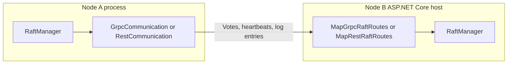

# Hosting Endpoints

Raft nodes send messages to each other all the time: vote requests, heartbeats, and log entries. With a network transport, each node receives these messages through endpoints in its own ASP.NET Core host. Kommander supplies the route map. Your host must expose it.

If a node does not map the routes, the other nodes cannot reach it. The node then receives no vote requests, no heartbeats, and no log entries.



Choose one transport and use it on every node. Map its routes in each process, as this page shows. For tests that run all the nodes in one process, use the in-memory transport. It needs no routes.

## gRPC

```csharp
using Kommander.Communication.Grpc;

builder.Services.AddKommanderGrpc();

WebApplication app = builder.Build();
app.MapGrpcRaftRoutes();
app.Run();
```

Use both helpers. `AddKommanderGrpc()` configures the server and applies `GrpcMaxMessageBytes` when the registered `IRaft` is available. `MapGrpcRaftRoutes()` maps the service and verifies its receive limit before the endpoint is built. If a host uses plain `AddGrpc()`, route mapping raises the Raft service limit when possible and logs a warning. If custom service wiring leaves the effective limit below `GrpcMaxMessageBytes`, Kommander logs an error; full batch frames can otherwise fail with gRPC `ResourceExhausted` and force replication streams to reconnect.

Use `GrpcCommunication` on the `RaftManager`:

```csharp
ICommunication communication = new GrpcCommunication();
```

## REST/JSON

```csharp
using Kommander.Communication.Rest;

WebApplication app = builder.Build();
app.MapRestRaftRoutes();
app.Run();
```

Use `RestCommunication` on the `RaftManager`:

```csharp
ICommunication communication = new RestCommunication();
```

For REST, configure `HttpScheme`, `HttpTimeout`, and `HttpVersion` on `RaftConfiguration`. For the transport authentication and the TLS settings, see [Security And Authentication](security-and-authentication.md).

`MapRestRaftRoutes` maps these protocol endpoints now:

| Method | Route |
| --- | --- |
| `POST` | `/v1/raft/handshake` |
| `POST` | `/v1/raft/request-vote` |
| `POST` | `/v1/raft/vote` |
| `POST` | `/v1/raft/append-logs` |
| `POST` | `/v1/raft/append-logs-batch` |
| `POST` | `/v1/raft/complete-append-logs` |
| `POST` | `/v1/raft/complete-append-logs-batch` |
| `POST` | `/v1/raft/batch-requests` |
| `GET` | `/v1/raft/get-leader/{partitionId}` |

## In-Memory

`InMemoryCommunication` is for tests and in-process simulations. It does not need a route map from ASP.NET Core.
