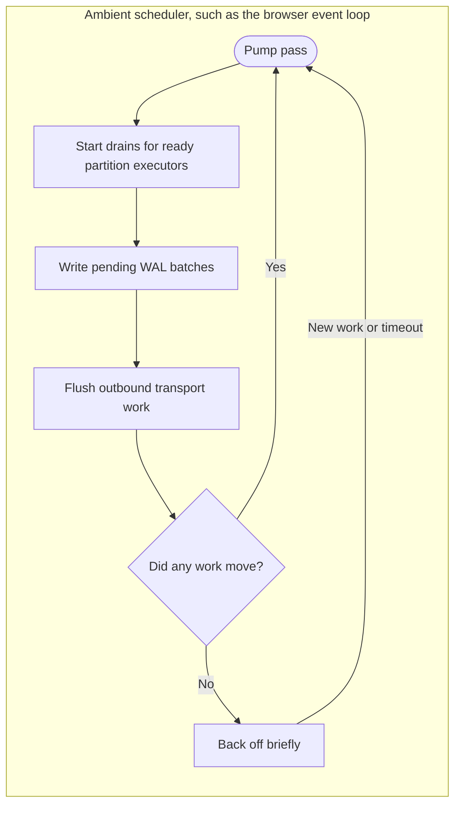

# Thread-Free Embedded Mode

Kommander can run in hosts that cannot create OS threads. The main target is single-threaded .NET WebAssembly, such as a browser tab or a Node.js-hosted `browser-wasm` app with `WasmEnableThreads` disabled.

In this mode, Kommander uses an async host pump instead of internal worker threads. The pump drives partition executors, WAL writes, and outbound transport dispatch from the ambient scheduler. In a browser, that scheduler is the browser event loop.

## When To Use It

Use the thread-free build when your application embeds Kommander in a runtime where `Thread.Start` and blocking waits are unavailable or unsafe.

Good fits include:

- browser demos and admin tools that need a local Kommander node
- WebAssembly smoke tests
- single-threaded embedded hosts
- deterministic harnesses that want explicit control over scheduling.

For ordinary server-side .NET deployments, use the normal target framework. The normal build keeps gRPC, REST server endpoints, RocksDB, SQLite, multicast discovery, and the standard scheduler workers.

## Target Frameworks

The Kommander package includes browser target frameworks:

- `net8.0-browser`
- `net10.0-browser`

Those targets define `KOMMANDER_THREAD_FREE`. A WebAssembly project must target a `-browser` framework to get the thread-free assembly:

```xml
<Project Sdk="Microsoft.NET.Sdk.WebAssembly">
  <PropertyGroup>
    <TargetFramework>net10.0-browser</TargetFramework>
    <RuntimeIdentifier>browser-wasm</RuntimeIdentifier>
    <WasmEnableThreads>false</WasmEnableThreads>
    <JsonSerializerIsReflectionEnabledByDefault>true</JsonSerializerIsReflectionEnabledByDefault>
  </PropertyGroup>
</Project>
```

Two details matter:

- use `net10.0-browser`, not plain `net10.0`
- enable reflection-based JSON unless your host supplies compatible source-generated metadata for the system state Kommander serializes.

If a WebAssembly app targets plain `net10.0`, it selects the normal assembly and can fail when the runtime reaches thread creation or server-transport dependencies.

## Scheduling Model

The thread-free build changes the default scheduler settings:

| Setting | Thread-free value | Why |
| --- | ---: | --- |
| `EnableInternalSchedulingThreads` | `false` | The build cannot create worker threads. |
| `EnableHostPumpedScheduling` | `true` | The node runs from the async host pump. |
| `EnableSharedExecutorPool` | `true` | Dedicated partition threads are not available. |

The host pump runs repeated non-blocking passes. A pass drains ready partition work, writes pending WAL batches, and flushes outbound transport work. When there is no work, it backs off briefly and wakes again when new work arrives.



Leave `EnableHostPumpedScheduling` enabled unless another driver explicitly pumps the node. With both internal threads and the host pump disabled, nothing advances.

## Available Components

The browser targets keep the pieces that can work without OS threads and unsupported native dependencies.

| Area | Browser/thread-free build |
| --- | --- |
| WAL | `InMemoryWAL` |
| Discovery | `StaticDiscovery` and programmatic discovery |
| Client transport | REST client and in-memory transport |
| Server transport | Not included |
| gRPC client | Not included |
| Durable WALs | RocksDB and SQLite adapters are not included |
| Multicast discovery | Not included |
| Certificate-based transport security | Not supported in the browser build |

The browser performs TLS itself. Configure `TransportSecurity.NodeAuthenticationMode` as `Disabled` or `SharedSecret`; `MutualTls`, client certificate paths, pinned server thumbprints, and insecure certificate validation are refused by validation in the browser build.

## Storage And Durability

Use `InMemoryWAL` in browser hosts. RocksDB and SQLite require native libraries and file-system behavior that the browser target does not include.

Because `InMemoryWAL` is volatile, browser-hosted nodes are best for demos, local coordination, testing, or workloads where another system owns durable state. Do not treat a browser tab with `InMemoryWAL` as crash-durable storage.

## Shutdown

Prefer:

```csharp
await raft.LeaveCluster(dispose: true, cancellationToken);
```

`LeaveCluster(dispose: true)` can await outstanding drains. A direct synchronous `Dispose` cannot block in the thread-free build, so it logs a warning if a drain cannot finish immediately and then continues disposal.

## Testing

The source tree includes two checks for this mode:

```shell
dotnet test Kommander.Tests/Kommander.Tests.csproj -p:KommanderThreadFree=true \
  --filter "FullyQualifiedName~TestHostPumpedScheduling"
```

and:

```shell
scripts/run-wasm-smoke.sh
```

The WebAssembly smoke app builds the browser target, runs under Node.js, starts a single-node cluster, commits proposals, and leaves. It catches thread starts, blocking waits, and scheduler stalls that a normal .NET test may hide.

## Related Reading

- [Configuration](../reference/configuration.md)
- [Adapters](../reference/adapters.md)
- [Deterministic Testing](../operations/deterministic-testing.md)
