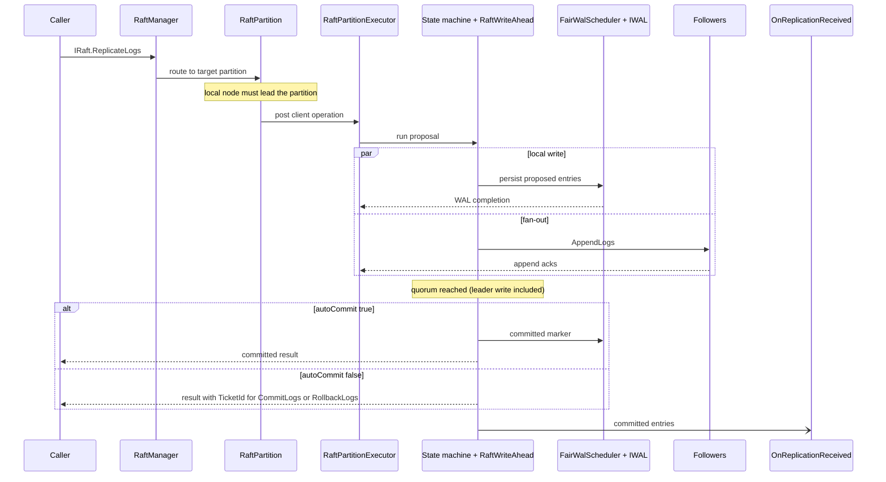

# Internals

This section explains how Kommander works below the public API. It is meant for developers who want to understand the runtime before operating it, debugging it, or contributing to it.

Kommander is organized around one core rule:

> A partition's mutable Raft state has one owner at a time.

That rule is why the current implementation uses explicit partition executors, fair WAL schedulers, and a system coordinator instead of letting many threads update Raft state directly.

## Main Components

| Component | Role |
| --- | --- |
| `RaftManager` | Process-level coordinator. Owns discovery, communication, partitions, schedulers, timers, and the system coordinator. |
| `RaftPartition` | Public-facing wrapper for one partition. Converts API calls and transport messages into executor operations. |
| `RaftPartitionExecutor` | Single-threaded owner of one partition's state transitions. |
| `RaftPartitionStateMachine` | Holds Raft state for a partition: role, term, votes, proposals, commit tracking, and leader expectations. |
| `RaftWriteAhead` | WAL facade for recovery, propose, commit, rollback, follower append, checkpoint, and compaction work. |
| `FairReadScheduler` | Runs synchronous WAL reads on fair, partition-aware worker queues. |
| `FairWalScheduler` | Runs synchronous WAL writes on fair, partition-aware worker queues. |
| `RaftTimerService` | Periodically injects leadership, heartbeat, discovery, and maintenance work. |
| `RaftTransportDispatcher` | Sends outbound protocol responses without mutating partition state directly. |
| `RaftSystemCoordinator` | Serializes system partition configuration changes, including partition range initialization and splits. |

## Request Flow

A typical application write follows this path:

1. The caller invokes `IRaft.ReplicateLogs`.
2. `RaftManager` finds the target `RaftPartition`.
3. `RaftPartition` checks that the local node is the partition leader.
4. The partition posts a client operation to `RaftPartitionExecutor`.
5. `RaftPartitionStateMachine` creates a proposal and asks `RaftWriteAhead` to persist it.
6. `FairWalScheduler` writes to the configured `IWAL` adapter.
7. The WAL completion is posted back to the same partition executor.
8. The leader sends append-log messages to followers.
9. After quorum completion, the proposal is committed or left for manual commit depending on `autoCommit`.
10. Committed entries reach the application through `OnReplicationReceived`.

The important point: network messages, timers, storage completions, and client calls all become partition operations. They do not mutate the partition state from random threads.

<ArchDiagram
  group="One partition"
  sources={[
    {label: 'Client calls', icon: 'user'},
    {label: 'Transport messages', icon: 'server'},
    {label: 'Timer ticks', icon: 'chip'},
    {label: 'WAL completions', icon: 'log'},
  ]}
  hub={{label: 'Partition executor', icon: 'layers'}}
  targets={[
    {label: 'RaftWriteAhead', sub: '(fair read and WAL schedulers, then IWAL)', icon: 'database'},
    {label: 'RaftTransportDispatcher', sub: '(outbound protocol messages)', icon: 'server'},
  ]}
  title="Client calls, transport messages, timer ticks, and WAL completions all enter the single partition executor, which alone mutates partition state and hands storage work to RaftWriteAhead and outbound messages to RaftTransportDispatcher."
/>

