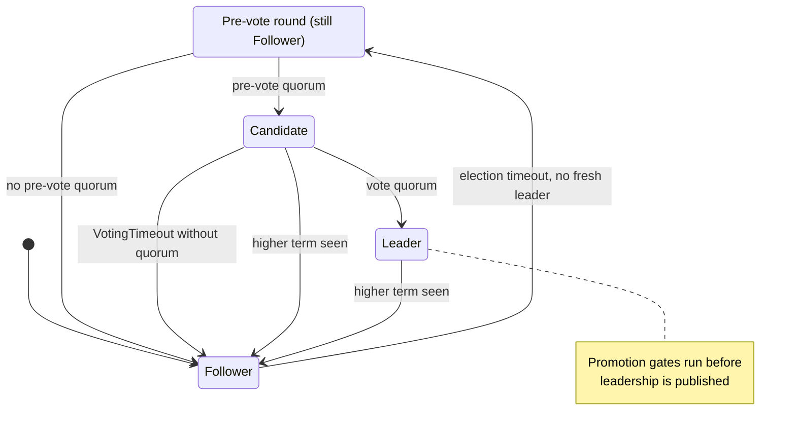
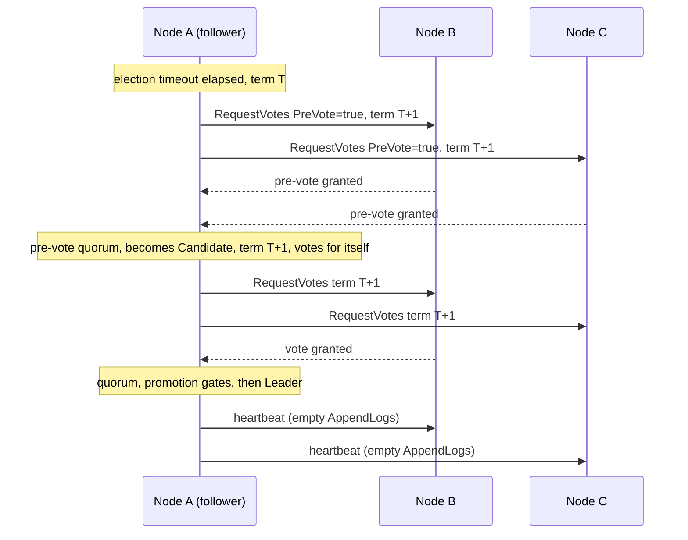

# Leader Election Internals

Each partition elects its own leader. This page explains how Kommander runs that election: the timeouts, the pre-vote round, and the repair checks that a new leader runs before it serves the application.

Read this page when you debug frequent leader changes, tune the election timeouts, or want to know why a node did not become leader. Elections are automatic. You do not need to start or manage them.

To act on leadership, read other pages. [Leadership Control](../operations/leadership-control.md) shows how to wait for a stable leader. [Leader Balancing](../operations/leader-balancing.md) spreads leaders across the nodes. The timing settings are in [Configuration](../reference/configuration.md).

## Node States

A partition state machine can be in one of the usual Raft roles:

| State | Meaning |
| --- | --- |
| Follower | Accepts leader messages and votes for candidates. |
| Candidate | Requests votes after the leader appears unavailable. |
| Leader | Accepts proposals and sends heartbeats or append-log messages. |

## Heartbeats

Leaders periodically send heartbeats. In Kommander, an empty append-log request acts as the heartbeat path.

Followers track the last heartbeat using hybrid logical clock timestamps. If the leader is quiet for longer than the election timeout, a follower may begin the election path.

## Election Timeout

Each partition chooses a randomized election timeout between:

- `StartElectionTimeout`
- `EndElectionTimeout`

Randomized timeouts reduce the chance that many followers become candidates at the same time.

When `ElectionTimeoutSeed` is set, each partition derives its random sequence from `ElectionTimeoutSeed ^ partitionId` instead of `Random.Shared`. That makes election timing reproducible for tests and simulations while still keeping partitions distinct.

If an election fails to find quorum, Kommander increases the timeout using:

- `StartElectionTimeoutIncrement`
- `EndElectionTimeoutIncrement`

## PreVote Phase

Kommander implements the Raft pre-vote pattern from section 9.6 of the Raft paper.

Before a follower increments its term or becomes a candidate, it first runs a side-effect-free pre-vote round for `currentTerm + 1`.

During this phase the follower:

1. stays a follower
2. does not bump `currentTerm`
3. does not record a real vote
4. asks peers whether they would vote for it if a real election started.

Peers only grant a pre-vote when:

- they do not consider a current leader fresh
- the proposed term is not stale
- the candidate's log is at least as up to date as their own.

Pre-vote requests and replies carry a `PreVote` flag on the vote RPCs so the transport can distinguish probes from real elections.

This matters because an isolated or stale node can no longer keep inflating terms and disrupting a healthy leader. If it cannot win a quorum, it never gets promoted into a real election.

## Becoming Candidate

Before becoming a candidate, a node checks whether it appears outdated compared with known commit indexes from other nodes. If it is behind, it does not start leadership and backs off.

When a follower reaches pre-vote quorum, Kommander promotes it into a real election. At that point it:

1. it clears the known leader
2. increments the term
3. votes for itself
4. asks peers for votes
5. waits for `VotingTimeout`.

If pre-vote does not reach quorum, the node remains a follower and no real election state is mutated.

## Becoming Leader

A candidate becomes leader when it reaches quorum. After leadership is established, it begins sending heartbeats and can accept proposals for that partition.

The term protects against stale messages. Requests from old leaders or old terms are rejected so an outdated node cannot continue committing work.

## Promotion-Gate Self-Repair

A winner can inherit a log with proposed entries, marker holes, or a divergent tail. Kommander uses promotion gates before it publishes leadership to the application. The gates drain safely committed inherited entries and repair tails that cannot be used by the new leader.

Some repair is destructive: it can truncate an orphaned tail or skip over a gap that no reachable quorum can fill. `SelfRepairPeerDownGrace` delays that destructive self-repair while a voter peer is not alive. This gives a briefly restarted voter time to return with the missing range before the survivors conclude the range is gone.

The default is `30 s`. Set it above the normal restart time for a voter in your environment. The grace is still bounded; after it expires, Kommander can self-repair so a permanently missing peer does not leave the partition leaderless forever.

## Why PreVote Helps

Pre-vote mainly improves behavior during partitions and recoveries.

One concrete case is a follower that becomes isolated while the other two nodes in a three-node cluster continue making progress. Without pre-vote, that stale follower can come back with an inflated term and create avoidable election churn. With pre-vote, it probes first, fails to get quorum while isolated, and rejoins as a follower when communication is restored.

## Heartbeat Throttling

Leaders throttle repeated heartbeats with the `RecentHeartbeat` window.

Kommander scopes that throttle key by both node and partition. That matters because one node can host many partitions at once. If throttling were keyed only by node, one active partition could suppress heartbeats for every other partition on the same follower and trigger avoidable elections.

`RecentHeartbeat` is measured with the monotonic tick source, not by subtracting hybrid-logical-clock timestamps from peers. That keeps a skewed peer clock from freezing heartbeat de-dup and silencing the repair path. The configuration must keep `RecentHeartbeat < HeartbeatInterval`; set it to `TimeSpan.Zero` in special test harnesses that intentionally disable the window.
