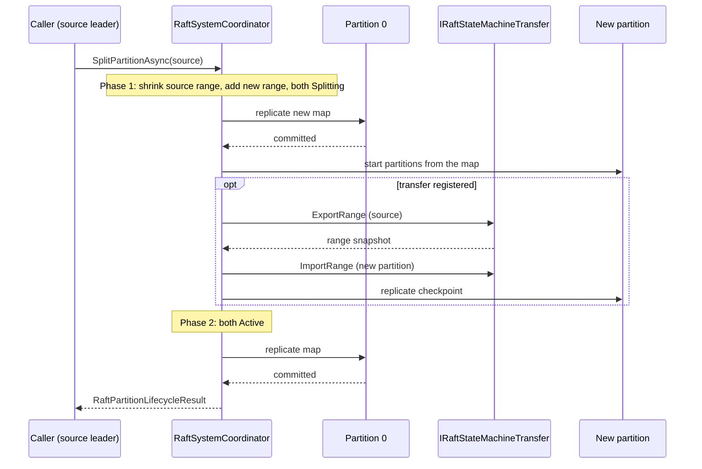
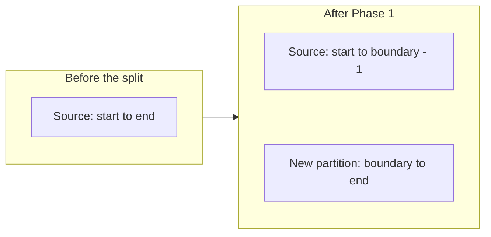

# Partitions And Splitting

Partitions divide the keyspace into independent Raft groups. This page explains how Kommander maps a key to a partition, and how every node keeps the same partition map.

Read this page when you want to know why a key goes to a given partition, or when you debug routing after a split. Routing is automatic: `GetPartitionKey` and `GetPrefixPartitionKey` find the partition for you.

To split, merge, create, or remove partitions, read [Elastic Partitions](../guides/elastic-partitions.md) and [Splitting A Hot Partition](../guides/splitting-a-hot-partition.md). This page explains only what happens inside a split.

Partition `0` is reserved for system configuration. User partitions start at `1`.

## Partition Ranges

The system coordinator stores partition ranges as replicated system configuration. A range maps a slice of the hash space to a partition id.

When user partitions are initialized, `RaftSystemCoordinator` divides the positive `int` hash space across `InitialPartitions` ranges. It starts with partition id `1`.

Application routing uses:

- `GetPartitionKey`, which hashes the prefix before the last `/`
- `GetPrefixPartitionKey`, which hashes the complete provided string.

`RaftManager` then finds the partition whose range contains the hash value.

## Why Ranges Are Replicated

Every node must agree on which partition owns which hash range. That map is replicated through the system partition so all nodes start and update user partitions from the same configuration.

## Splitting A Partition

`IRaft.SplitPartitionAsync` sends a split request to the system coordinator. The older `RaftManager.SplitPartition(partitionId)` method is only a wrapper on `RaftManager`. It calls `SplitPartitionAsync`.

The call throws a `RaftException` in these conditions:

- The node is not initialized.
- The source partition is `0`.
- The local node is not the leader of the source partition.

A `RaftSplitPlan` can set three options:

- `TargetPartitionId`: the id of the new partition. If you leave it at `0`, the coordinator uses the highest current partition id plus one.
- `HashBoundary`: the first hash value of the new partition. If you leave it empty, the coordinator uses the midpoint of the source range.
- `TargetRoutingMode`: `HashRange` (the default) or `Unrouted`. An `Unrouted` partition ignores `HashBoundary`.

A split has two phases:

1. **Phase 1.** The coordinator shrinks the source range so that it ends below the boundary. It creates the new partition for the hash values from the boundary to the end of the old source range. It marks both partitions as `Splitting`, and replicates the new map through the system partition.
2. **State transfer.** If an `IRaftStateMachineTransfer` is registered, the coordinator exports the moved range from the source partition and imports it into the new partition. It then replicates a checkpoint into the new partition, so all its replicas converge on the imported state. This step is an optimization. If it fails, the split continues without it.
3. **Phase 2.** The coordinator marks both partitions as `Active`. `SplitPartitionAsync` always starts Phase 2 automatically after Phase 1.

Each node starts or updates its local partitions from the replicated map.

## Current Scope

A split changes the routing map and starts the new partition. It moves application state only if every node registers an `IRaftStateMachineTransfer`. Without a transfer, your application must move the state of the moved range itself. See [State Transfer During A Split](../guides/elastic-partitions.md#state-transfer-during-a-split).

If your state machine keeps derived indexes or external projections, design them so you can rebuild or move them when the range map changes.
