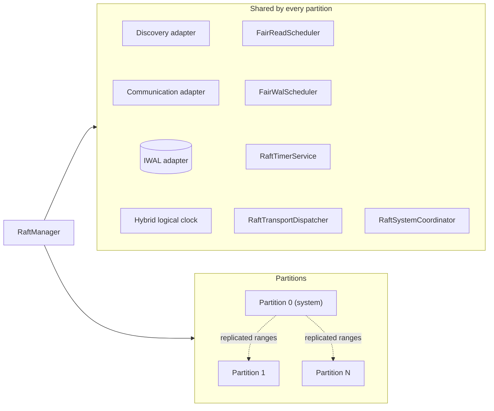
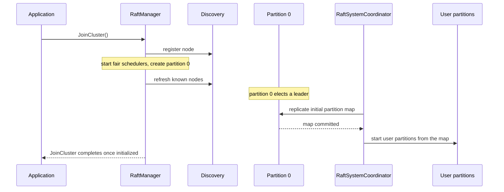

# Runtime

Kommander's runtime is process-level coordination plus per-partition ownership. One `RaftManager` object coordinates the process. Each partition owns its own Raft state.

Read this page when you debug startup or shutdown, or when you want to know which object owns which resource. It shows what `JoinCluster` starts, and the order in which `LeaveCluster` stops it. You do not need to manage these parts yourself.

To build and start a node, read [Creating A Node](../guides/creating-a-node.md).

## `RaftManager`

`RaftManager` is the main runtime object. It owns:

- local node identity and endpoint
- discovery adapter
- communication adapter
- WAL adapter
- hybrid logical clock
- system partition
- user partitions
- fair read scheduler
- fair WAL scheduler
- timer service
- transport dispatcher
- system coordinator.

`JoinCluster` registers the node through discovery, starts the fair schedulers, creates the system partition, and waits until user partitions are initialized.

`LeaveCluster` stops work in a deliberate order:

1. stop timers so no new periodic work is injected
2. stop user partition executors
3. stop the system partition executor
4. stop transport dispatch
5. stop the system coordinator
6. stop read and WAL schedulers
7. optionally dispose owned resources.

## System Partition

Partition `0` is the system partition. It stores cluster metadata used by Kommander itself, especially partition ranges.

Application code should not replicate data to partition `0`. Public replication APIs reject userland writes to the system partition.

## User Partitions

User partitions start at `1`. They are created from ranges replicated through the system partition. Each user partition has:

- a range of hash values
- its own Raft leader
- its own executor
- its own state machine
- its own WAL recovery and commit path.

Different partitions can have different leaders. That is how Kommander spreads coordination work across nodes while keeping strict order inside a single partition.
