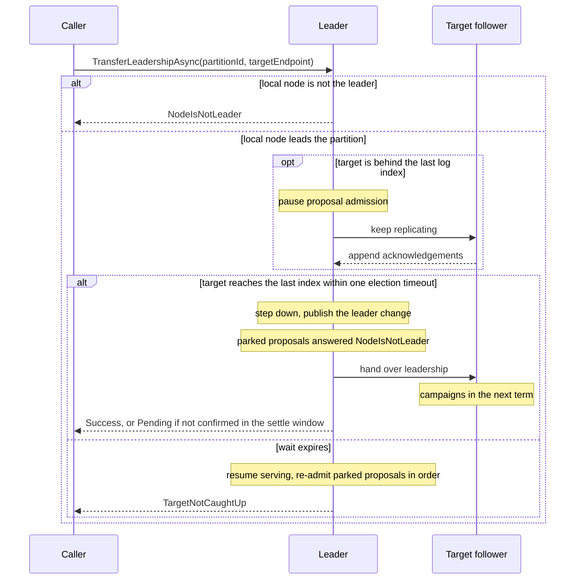

# Leadership Control

Use the APIs on this page when your code must know which node leads a partition, or when a test must move leadership at a known moment.

The APIs fall into two groups:

- **Leader waiting.** `WaitForLeader` and `WaitForLeaderStableAsync` wait until a partition has a leader. Call them at startup or after a failover, before you route requests to the leader. They stop your service from acting on a leader that is still changing.
- **Leadership movement.** `StepDownAsync`, `TransferLeadershipAsync`, and the heartbeat hooks are test hooks. Use them in deterministic tests and controlled experiments to cause a failover on purpose. They are not normal application APIs.

To spread leaders across the nodes of a production cluster, do not call `TransferLeadershipAsync` from your own code. Enable the [leader balancer](leader-balancing.md) instead. It moves leadership in small steps.

## Stable Leader Waiting

`WaitForLeaderStableAsync` waits until the same non-empty leader endpoint has remained stable for a minimum duration.

Prefer the overload with an overall timeout:

```csharp
string stableLeader = await raft.WaitForLeaderStableAsync(
    partitionId: 1,
    minStableFor: TimeSpan.FromMilliseconds(500),
    timeout: TimeSpan.FromSeconds(10),
    cancellationToken: cancellationToken
);
```

This is useful when you do not want to react to a leader that is still flapping during startup or failover.

The overload without `timeout` treats `minStableFor` as a stability window, not as a deadline. It waits until the window is satisfied or the cancellation token is cancelled. If leadership churns and the token is unbounded, that wait can be unbounded too.

## Restore-Aware Leader Waiting

`WaitForLeader` waits for partition restore to complete before it starts its fixed leader-election polling budget.

That distinction matters for large durable WALs. A slow replay should not look like a failed election. Bound the whole call with your cancellation token:

```csharp
using CancellationTokenSource timeout = new(TimeSpan.FromSeconds(30));
string leader = await raft.WaitForLeader(1, timeout.Token);
```

If restore fails, `WaitForLeader` throws a `RaftException` whose inner exception is the restore failure.

## Step Down

`StepDownAsync` asks the local leader to step down while keeping the node online as a follower:

```csharp
RaftOperationStatus status = await raft.StepDownAsync(
    partitionId: 1,
    cancellationToken: cancellationToken
);
```

The runtime can notify other nodes with a step-down notice so a new election can start promptly.

## Leadership Transfer

`TransferLeadershipAsync` asks the local leader to hand leadership to a specific follower:

```csharp
RaftOperationStatus status = await raft.TransferLeadershipAsync(
    partitionId: 1,
    targetEndpoint: "node-b:2070",
    cancellationToken: cancellationToken
);
```

The target no longer has to be perfectly caught up when the call starts. If it is behind, the leader pauses new proposal admission for that partition, keeps replicating to the target, and hands over as soon as the target reaches the leader's last log index. That catch-up wait is bounded by one election timeout.

Important outcomes:

- `Success` means the target was observed as the new leader
- `Pending` means the handoff was sent, but the successor was not confirmed within the settle window
- `TargetNotCaughtUp` means the target did not reach the leader's last index before the bounded wait expired, so the original leader resumed serving
- `NodeIsNotLeader` means the local node was not the partition leader before it could accept the transfer request.

While the handoff is pending, proposals are answered `NodeIsNotLeader` only after the leader change is published. If the target fails to catch up, the parked proposals are re-admitted in order.



## Heartbeat Suspension

Two additional hooks exist for fault-injection tests:

- `SuspendHeartbeatsAsync`
- `ResumeHeartbeatsAsync`

These let tests pause and resume periodic outbound heartbeats for a partition without disabling all Raft traffic.

## Scope

`StepDownAsync`, `TransferLeadershipAsync`, `SuspendHeartbeatsAsync`, and `ResumeHeartbeatsAsync` are exposed on `IRaft`, but they are marked as advanced test hooks in the codebase. Treat them as deterministic-test and controlled-experiment tools, not normal application write APIs.
