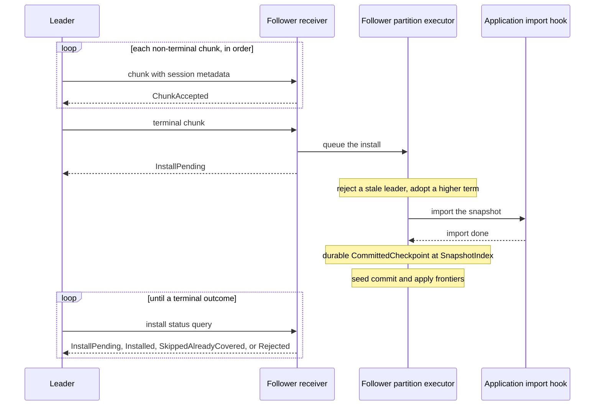
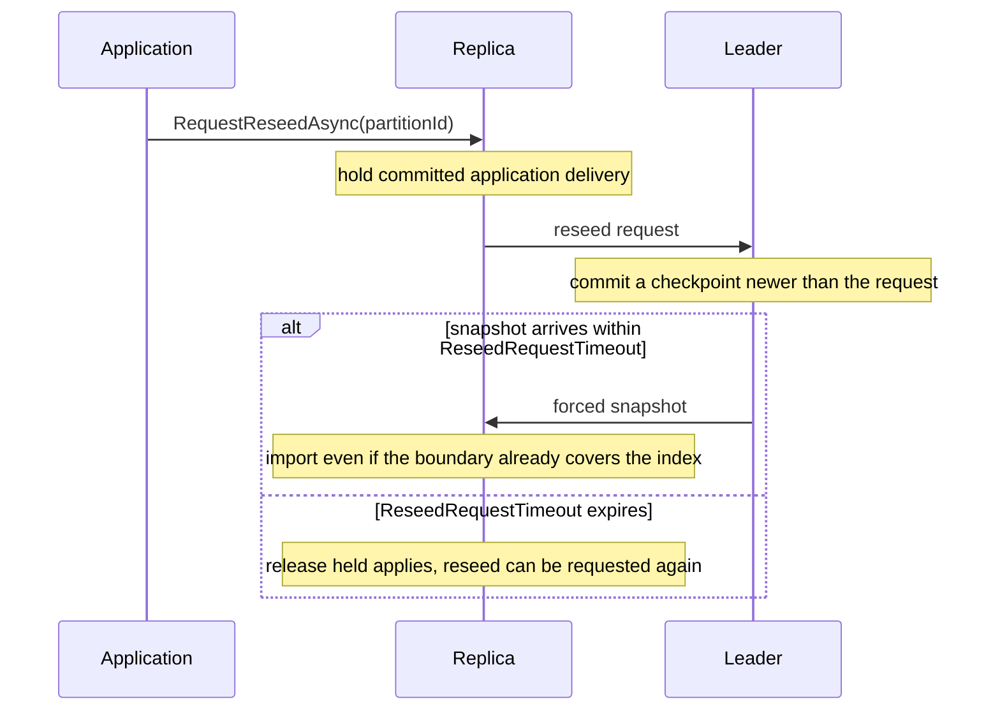

# Snapshot Installation

Snapshot installation repairs a node that is too far behind to catch up from the log. Without it, a node that was offline during a compaction cannot catch up. A new node that joins after a compaction also cannot catch up.

Kommander starts snapshot installation automatically. But Kommander does not know the format of your application state, so your application must supply the export and the import. Register a transfer hook on every node, before `JoinCluster`:

- `RegisterPartitionStateTransfer` repairs a lagging replica of a user partition. If it is not registered, Kommander falls back to the range hook below.
- `RegisterStateMachineTransfer` moves a key range during a split or a merge.
- `RegisterSystemStateTransfer` repairs the application state on partition `0`.

If no suitable hook is registered, a follower below the compaction floor stays stuck. `GetSnapshotStatuses` on the leader then reports `Unproducible = true` for that follower. Read this page to implement the hooks correctly, and to size the memory and the timeouts of a transfer.

Kommander uses snapshot installation when ordinary log backfill cannot repair a node that lags behind. Backfill is the transfer of missing committed log entries from the leader.

Backfill works while the leader still holds the missing committed log entries. Compaction removes those entries. A follower or a learner then needs a compact snapshot of the application state instead of the individual log records.

## When It Runs

Snapshot installation can run in these conditions:

- A follower is below the compaction floor of the leader.
- A learner joins after the compaction of old history.
- The application deltas on partition `0` need a repair of the whole state.
- A split or a merge of a user partition needs a move of the range state.
- A replica asks the leader for a forced reseed because its application projection is missing or untrusted.

Snapshot installation is a fallback after log repair cannot produce the missing committed entries. If the leader still has the needed log range, Kommander prefers backfill because it is smaller and preserves ordinary log convergence.

Kommander selects the snapshot kind from the partition and the registered transfer hooks:

| Snapshot kind | Used for | Required hook |
| --- | --- | --- |
| `Range` | The move of a user-partition range for a split or a merge. It is also the fallback for the catch-up of a user partition when `IRaftPartitionStateTransfer` is not registered. | `IRaftStateMachineTransfer` |
| `PartitionState` | The whole application state of a user partition, for the catch-up of a lagging replica. | `IRaftPartitionStateTransfer` |
| `SystemState` | The whole application state on partition `0`. | `IRaftSystemStateTransfer` |

Partition `0` stays reserved for system-wide state. An application write there must use its own log type. It must never use `_RaftSystem`.

## Implement The Partition State Transfer

Implement `IRaftPartitionStateTransfer` when your application keeps state for user partitions and the cluster compacts its WAL. This hook is the primary way to seed a replica under [replica placement](../guides/replica-placement.md). A new replica of a range whose WAL is already compacted can catch up only this way.

```csharp
public interface IRaftPartitionStateTransfer
{
    Task<Stream> ExportPartitionState(int partitionId, long upToIndex, CancellationToken ct);
    Task ImportPartitionState(int partitionId, Stream snapshot, CancellationToken ct);
}
```

Register it on every node that can host or lead a user partition. The leader needs the export, and the follower needs the import. The registration is not replicated:

```csharp
raft.RegisterPartitionStateTransfer(new OrderStoreTransfer(store));
```

The implementation must follow these rules:

- `ExportPartitionState` must include at least every entry applied up to `upToIndex`. It can include newer state, for example from an MVCC snapshot. It must never include less, because that loses data.
- The receiver replays the retained entries above `upToIndex` onto the imported state. An entry that the snapshot already contains must therefore have no effect when it is applied again.
- `ImportPartitionState` must replace the state of the partition atomically. A crash during the import must leave the old state intact.
- Kommander can call `ImportPartitionState` more than once for the same snapshot. A repeated import must give the same result.
- Both methods run on background tasks. If one instance serves several partitions, it must be thread-safe.

Kommander reads the exported stream in chunks, and then disposes it.

:::warning Mixed-version clusters
A node that runs an older Kommander version does not know the `PartitionState` snapshot kind. That node gives the snapshot to `IRaftStateMachineTransfer.ImportRange` instead, so your application receives data in the wrong format. During a rolling upgrade, do not register the partition-state transfer until every node runs a version that supports it.
:::

## Receive Contract

Kommander divides a large snapshot into bounded chunks. Every chunk in one transfer carries the same session metadata:

- `SessionId`
- `PartitionId`
- `SnapshotIndex`
- `LeaderTerm`
- `LeaderEndpoint`
- `LastIncludedTerm`
- `SnapshotKind`.

The receiver accepts the chunks in order only. It treats an exact duplicate of the immediately previous chunk as an idempotent success. It rejects a skipped, reordered, or negative chunk and drops the session. It also rejects a chunk that changes the metadata.

## Bounded Memory

The follower keeps the in-progress receive sessions bounded.

| Setting | Default | Description |
| --- | ---: | --- |
| `SnapshotReceiveSessionTtl` | `30 s` | The idle time before the next receive sweep expires an incomplete receive session. |
| `SnapshotMaxPendingSessions` | `8` | The maximum number of concurrent receive sessions across all partitions on one node. |
| `SnapshotMaxPendingBytes` | `512 MiB` | The maximum total bytes that the active sessions and the sessions in install hold in a buffer. |
| `SnapshotStagingDirectory` | `null` | A node-private directory for snapshot spill files. `null` keeps every receive session in memory. |
| `SnapshotStagingMemoryBytes` | `64 MiB` | The resident staging budget when a spill directory is configured. `0` stages every session on disk. |
| `AllowLegacySnapshotSenders` | `false` | Accepts snapshot senders that do not fill the leader fields and the boundary fields. Use it temporarily. |
| `SnapshotTransferStepTimeout` | `2 min` | The maximum time an outbound export step, stream read, or chunk send may make no progress before Kommander fails that attempt and retries later. |
| `SnapshotChunkAckTimeout` | `15 s` | The maximum time a sender waits for one chunk acknowledgement. This is also the transport deadline for the chunk request on supported transports. |
| `SnapshotRescueMaxConsecutiveCycles` | `3` | Consecutive below-floor rescue cycles before the leader trips a convergence breaker for that follower. |
| `SnapshotRescueProbeInterval` | `5 min` | How often the leader allows one probe rescue while the breaker is tripped. |
| `SnapshotExportRetryCacheMaxBytes` | `64 MiB` | Maximum snapshot export kept in memory for retries at the same snapshot index. Larger snapshots stream without retry caching. |
| `ReseedRequestTimeout` | `3 min` | Maximum time a follower-requested reseed may hold committed applies while waiting for the forced snapshot. |
| `WalStallWarnThreshold` | `500 ms` | Pending WAL-write age at which snapshot open or transfer is deferred for a durable-write stall. |

A new session or a new chunk can exceed the count cap or the byte cap. Kommander then evicts the pending sessions with the oldest activity first. Kommander rejects one snapshot that cannot fit inside `SnapshotMaxPendingBytes`.

A completed snapshot stays charged against the byte cap during its install. Therefore, a slow application import cannot let total staged data grow without a bound.

Without `SnapshotStagingDirectory`, `SnapshotMaxPendingBytes` is both the memory limit and the largest snapshot the node can receive. With a directory configured, the same option bounds memory and spill files together, while `SnapshotStagingMemoryBytes` bounds only resident staged bytes. A session moves to a spill file before its next chunk would exceed the resident budget. This lets a memory-limited node receive a partition snapshot larger than its heap budget.

The directory must be private to one Kommander node. Session cleanup removes normal spill files, and startup removes files left by a crash. A full disk or another spill write failure fails only that receive session; the sender retries through the normal path.

Snapshot receive staging uses a segmented buffer instead of one growing contiguous stream. The configured caps are still counted in payload bytes, but the segmented shape avoids repeated growth-copy costs for large snapshots and keeps memory overhead closer to the data actually being staged.

A receiver refuses to open a new snapshot session while its local WAL reports a durable-write stall at or above `WalStallWarnThreshold`. The snapshot could not install until the disk answers, and buffering it would only consume the bounded receive budget. The leader retries after the stall clears.

## Chunk Outcomes

Snapshot chunk acknowledgements carry a typed `SnapshotInstallOutcome`:

| Outcome | Meaning |
| --- | --- |
| `ChunkAccepted` | A non-terminal chunk was staged in order. It says nothing about final installation yet. |
| `InstallPending` | The snapshot is staged and an install for this partition is queued or running. The sender polls for its outcome. |
| `Installed` | The application import completed and the durable WAL boundary was written. |
| `SkippedAlreadyCovered` | The receiver already had a compatible snapshot boundary at or above this index, so no import was needed. |
| `NoInstall` | A status query found no running install or retained outcome for the named session. The sender restarts the transfer. |
| `Rejected` | The chunk or install was refused. The sender records a failure and retries later. |

The terminal chunk starts installation on the partition executor and returns `InstallPending` as soon as the snapshot is staged and verified. The leader then sends status queries until the receiver reports `Installed`, `SkippedAlreadyCovered`, or a failure. A slow import is therefore not misclassified as a failed chunk.



Only one install per partition can be queued or running. While it runs, the receiver does not stage another snapshot for that partition. A retry or a new leader discovers the existing install and waits for its outcome instead of exporting and buffering a duplicate.

This distinction matters operationally. A terminal success means the receiver's boundary covers the snapshot index, but `Installed` and `SkippedAlreadyCovered` tell you whether the receiver actually imported state during this attempt. A missing outcome is treated as `Rejected`, not as a silent success.

`SnapshotChunkAckTimeout` bounds one request/response for a chunk or install-status query. It does not bound the whole application import. `SnapshotTransferStepTimeout` bounds export, stream reads, and how long an install can go without reporting progress. For a chunk send, the effective timeout is the smaller of the two.

`GetSnapshotStatuses(partitionId)` sets `AwaitingInstall` and `AwaitingInstallIndex` while a transfer has finished sending and waits for the receiver's install. `InFlightFor` can exceed `SnapshotTransferStepTimeout` in this state when the importer continues to report progress.

## Rescue Breaker And Retry Cache

Snapshot rescue handles a follower that has fallen below the leader's compaction floor. Normally, one successful snapshot install lets the follower resume from the snapshot boundary.

If a follower repeatedly reports itself below the floor after successful installs, the leader trips a convergence breaker after `SnapshotRescueMaxConsecutiveCycles`. While the breaker is tripped, Kommander stops exporting the same full snapshot on every cooldown. It still allows one probe every `SnapshotRescueProbeInterval`, so a follower can recover without a manual reset when the underlying problem clears.

`GetSnapshotStatuses(partitionId)` shows this condition as `RescueNotConverging`.

The leader can cache a produced snapshot export for retries at the same snapshot index when the export is no larger than `SnapshotExportRetryCacheMaxBytes`. This avoids rerunning the application's export hook for every retry during a transient send failure. Larger snapshots are streamed chunk-by-chunk and are not cached.

If a follower reports a durable-write stall, the leader defers snapshot transfer even when the follower is below the compaction floor. The follower still receives heartbeats, and the leader retains a bounded log tail at the follower's durable frontier. Once the disk answers, catch-up can often resume from log backfill instead of pushing a large snapshot.

## Forced Reseed Snapshots

`IRaft.RequestReseedAsync(partitionId)` lets a replica request a fresh whole-partition snapshot from the current leader even when normal Raft catch-up does not require one. Use this when the local application projection is incomplete or untrusted while the replica's Raft log may still look caught up.

The request is made on the replica that needs repair. That replica holds committed application delivery for the partition, sends a reseed request to the leader, and waits for a fresh checkpoint. The leader commits a checkpoint newer than the request and ships a forced snapshot. The receiver imports that snapshot even when its existing boundary already covers the snapshot index, because the goal is to repair application state rather than to advance the Raft log boundary.



The same import and durability rules still apply:

- the application transfer hook must be registered before the snapshot arrives
- the final install runs on the partition executor
- stale leader checks and WAL boundary writes remain serialized with partition work
- WAL-stall deferral still protects a receiver whose disk is not answering.

Forced reseed does not use the snapshot rescue breaker as a reason to skip import, but it is still bounded by `ReseedRequestTimeout`. If the timeout expires, the follower releases held applies and can request reseed again after the operator or application decides the repair is still needed.

Pair reseed with `SetCandidacyWithheld(partitionId, true)` while the application state is suspect. A withheld replica remains a follower participant, but it does not campaign and it is not accepted as a leadership-transfer target.

## Durable Install Order

Kommander does not import the final chunk directly on the transport thread. It stages the complete snapshot. It then sends the install to the single-writer executor of that partition.

The executor does the durable sequence:

1. It rejects a stale leader by the term and the accepted leader endpoint.
2. It adopts a higher leader term with the same step-down rule as the other leader RPCs.
3. It calls the import hook of the application.
4. It installs a durable `CommittedCheckpoint` boundary in the WAL. The WAL is the write-ahead log.
5. It seeds the in-memory commit frontier and apply frontier from the snapshot boundary.
6. It permits normal backfill again after `SnapshotIndex`.

This order keeps the snapshot import, the term changes, the WAL changes, and the application delivery serial with every other partition operation.

Installing a snapshot does not make Kommander skip committed entries above the snapshot boundary. After the boundary is installed, the partition executor continues delivery from the first committed entry after `SnapshotIndex` in log order. If entries above the boundary were already present before the install, they remain part of the suffix unless the boundary term proves the suffix conflicts.

## Application Import Requirements

Your import method must be idempotent for the snapshot identity:

```text
(partitionId, SnapshotIndex, LastIncludedTerm)
```

The application import can succeed while the WAL boundary write fails. The sender then sees a failure and retries the snapshot. The second import must leave the same final state.

Prefer an atomic replace pattern for a snapshot file or an embedded store:

1. Write the imported state to a temporary location.
2. Validate it.
3. Swap it into place atomically.
4. Record the snapshot index with the state.

## WAL Boundary Behavior

An install of a snapshot boundary writes a durable `CommittedCheckpoint` at `SnapshotIndex`.

The follower can already have a log entry at that index with the same term. Kommander then keeps the suffix above the boundary. If the term is different, Kommander truncates the suffix. Normal backfill then repairs the suffix from the leader.

Each built-in WAL backend implements the boundary write:

| WAL | Boundary behavior |
| --- | --- |
| `RocksDbWAL` | Deletes the conflicting suffix entries and writes the checkpoint in one RocksDB `WriteBatch`. |
| `SqliteWAL` | Probes the boundary term, deletes the conflicting suffix entries, and upserts the checkpoint. It uses one SQLite transaction under the shard lock. |
| `InMemoryWAL` | Applies the same retain-or-truncate rule under its in-memory partition guard. |

## Operational Notes

- Register the snapshot transfer hooks before `JoinCluster`.
- Keep `SnapshotMaxPendingBytes` well above the size of your largest snapshot plus one install in flight.
- Configure a node-private `SnapshotStagingDirectory` when the largest partition snapshot should not reside entirely in memory.
- Size `SnapshotStagingMemoryBytes` for the receive memory you can afford and monitor disk capacity for spill files.
- Enable `GrpcEnableSnapshotCompression` when the snapshots are large and the network bandwidth is tighter than the CPU.
- Keep `AllowLegacySnapshotSenders = false` for a normal cluster.
- Keep `SnapshotTransferStepTimeout` comfortably above normal application export and network chunk latency. It is a progress timeout, not a whole-snapshot deadline.
- Size `SnapshotExportRetryCacheMaxBytes` from available heap and normal snapshot size. Set it to `0` or lower only when retry caching is unwanted.
- If `GetSnapshotStatuses` reports `RescueNotConverging`, inspect the follower's storage and application import path. The leader will probe again according to `SnapshotRescueProbeInterval`.
- A learner join can time out after heavy compaction. Register the relevant transfer hook on every node.

## Related Reading

- [System Partition State Snapshots](../guides/system-partition-state-snapshots.md)
- [Elastic Partitions](../guides/elastic-partitions.md)
- [Log Backfill And Catch-Up](../guides/log-backfill-and-catch-up.md)
- [Checkpoints And Compaction](./checkpoints-and-compaction.md)
- [Configuration](../reference/configuration.md)
