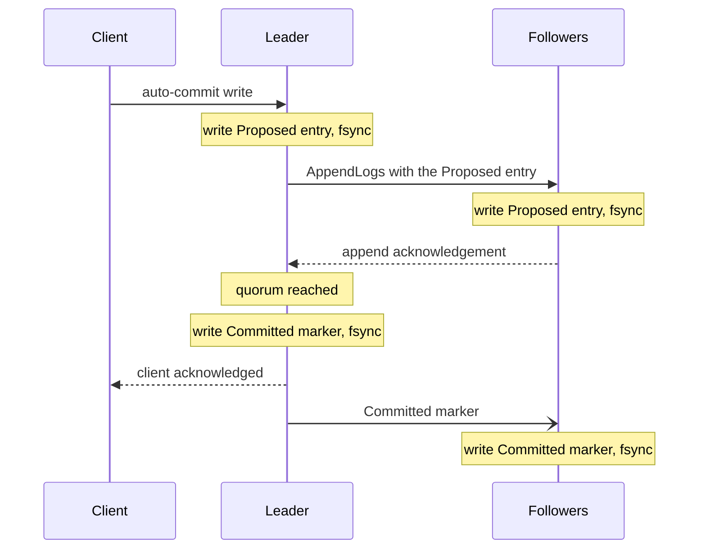
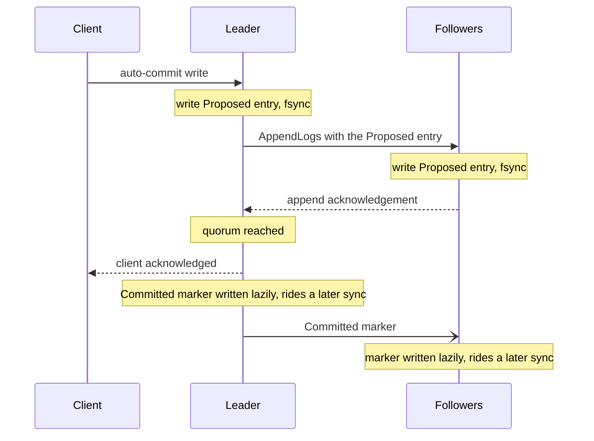
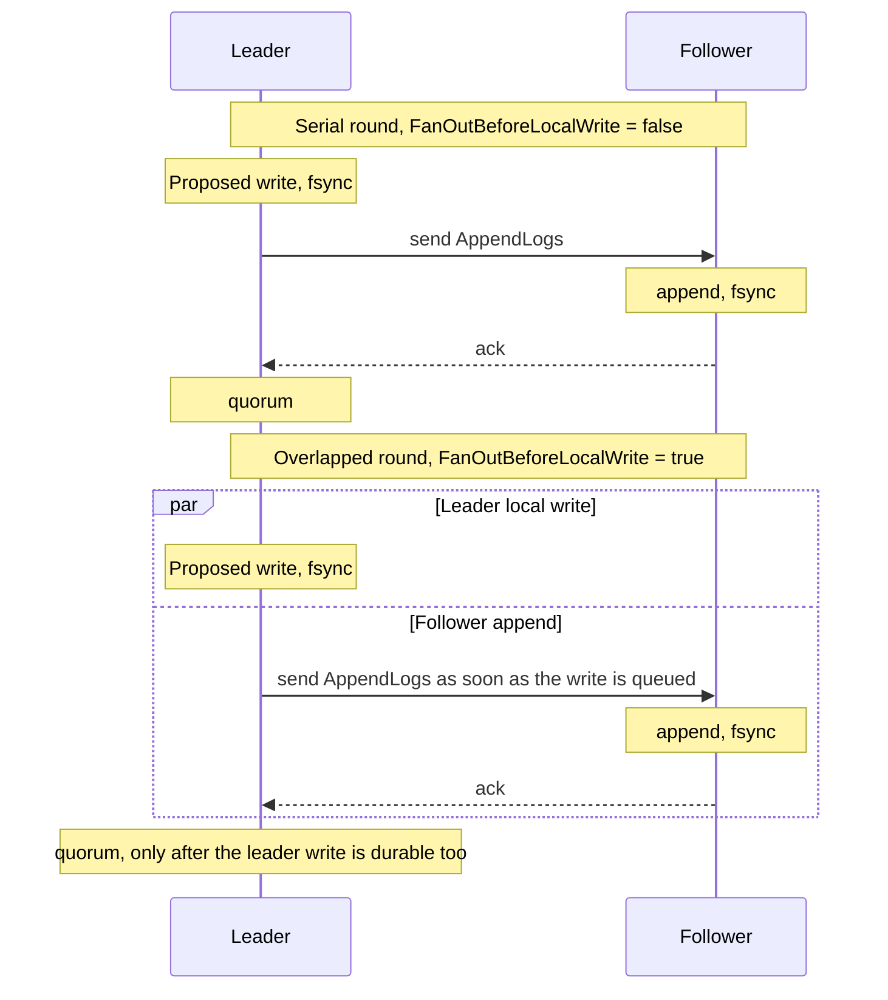

# WAL Commit Durability

Read this page when the write latency on durable storage is too high, or when you must know exactly when a write is safe after a crash. On RocksDB or SQLite, the disk sync can be the largest part of the write latency. Kommander has settings that reduce that cost without weakening the Raft durability rule.

For the common case, you do not need to act. `WalSingleFsyncCommit` and `FanOutBeforeLocalWrite` are on by default. `WalGroupCommitLingerMs` is off by default (`0`). Enable it only after you measure small WAL batches. If your application applies the committed entries to its own storage asynchronously, configure `ApplicationDurabilityProvider`. See [Application Durability Floor](#application-durability-floor).

Kommander persists the Raft log entries through the configured write-ahead log (WAL).

For a durable backend such as RocksDB or SQLite, Kommander keeps the Raft durability invariant. It also avoids an unnecessary sync that the client can see on the common auto-commit path. A sync is an fsync, which is a durable flush to disk.

Without the single-fsync fast path, a normal auto-commit write does two durable syncs:

1. It writes the proposed entry and syncs it.
2. It writes the committed marker after the quorum acknowledgement, then syncs it.

That older two-sync path is safe and predictable. The storage sync latency can still dominate the write latency. Kommander gives WAL settings that reduce the cost in different ways:

- `WalGroupCommitLingerMs` improves the batch density and the throughput when concurrent writes arrive at staggered times.
- `WalSingleFsyncCommit` removes the second sync from the auto-commit path that the client can see.
- `FanOutBeforeLocalWrite` overlaps the leader's proposed-entry write with follower appends.

These settings apply to a durable WAL adapter. `InMemoryWAL` does no fsync. A durable adapter with `syncWrites: false` already trades crash durability for test speed or benchmark speed.

## What Makes An Entry Durable

Raft treats an entry as committed when a quorum stores it durably.

The default WAL representation of Kommander stores two records:

- a `Proposed` record, written before the replication
- a `Committed` marker, written after the entry reaches the quorum.

The second marker makes the restart recovery cheaper, because the WAL describes the committed prefix directly. The marker is not the reason that the entry is durable on a quorum. The quorum-durable proposed entry is the Raft commit point.

## Two-Sync Path

With `WalSingleFsyncCommit = false`:



Each follower also receives a committed marker and syncs it.

Therefore, one auto-commit write can wait for two serial syncs on the leader path. Group commit can amortize the syncs across many writes. The write still waits for both phases.

## Group Commit Linger

`FairWalScheduler` already batches the ready WAL work across partitions. A worker can drain a maximum of `MaxWalGroupBatchPartitions` ready partitions. It then makes one `IWAL.Write` call.

<ArchDiagram
  group="Up to MaxWalGroupBatchPartitions ready partitions"
  sources={[{label: 'Partition 1', icon: 'log'}, {label: 'Partition 2', icon: 'log'}, '…', {label: 'Partition N', icon: 'log'}]}
  hub={{label: 'FairWalScheduler worker', icon: 'layers'}}
  targets={[{label: 'One IWAL.Write', sub: '(one shared storage sync)', icon: 'database'}]}
  title="Ready WAL work from many partitions is drained by one FairWalScheduler worker into a single IWAL.Write call that shares one storage sync."
/>

`WalGroupCommitLingerMs` adds a short adaptive wait after the worker finds the first ready partition. That wait gives more partitions a chance to arrive and share the same storage sync.

Use the linger in these conditions:

- The writes spread across many partitions.
- The WAL batches stay small, even under a meaningful load.
- The follower append traffic arrives at staggered times and causes many near-solo syncs.
- The storage sync cost is visible in a latency profile or a throughput profile.

Start with a small value such as `2 ms`. Then measure the result. A value of `0` keeps the default opportunistic batches.

The linger window is adaptive. The worker does not wait for the full window if no other ready partition arrives. A full group batch also syncs immediately.

`ReplicateEntries` can reduce the proposal overhead and the transport overhead before the work reaches the WAL scheduler. A heterogeneous batch with auto-commit entries only is one proposal. A batch with a trailing manual group is one auto group plus a manual suffix. The WAL scheduler still controls the storage calls and the fsync coalescence through the same group commit settings.

## Single-Fsync Commit Fast Path

`WalSingleFsyncCommit` changes the auto-commit path.

The setting is enabled by default. An `autoCommit` write then acknowledges the client as soon as the proposed entry is durable on a quorum. The runtime still writes the committed marker of each entry afterward. It writes the marker lazily, so the marker can ride a later sync.



This is a latency optimization. It removes one serial sync from the path that the client can see. It applies to the common single-round auto-commit write.

It does not apply to an explicit two-phase write. In that case, the caller uses `autoCommit: false`, then calls `CommitLogs` or `RollbackLogs`. That path keeps its separate durable commit behavior.

The lazy marker path applies only when the node already holds the entry durably as a proposed row. If a follower receives a `Committed` row or `CommittedCheckpoint` as the first local write for that log id, Kommander treats it as first durability and syncs it. This preserves crash durability for followers that receive the committed form before they have written the proposed form locally.

## Fan-Out Before Local Write

`FanOutBeforeLocalWrite` is enabled by default. The leader sends a new proposal to followers as soon as its own `Proposed` write is queued, rather than waiting for that local write to become durable first. The leader's WAL write and the followers' WAL writes can then run at the same time.



The meaning of an acknowledgement does not change. A proposal is not treated as quorum-complete until the leader's own write is durable too. Followers can answer first, but `RaftProposalQuorum` keeps the proposal short of quorum until the leader's local durability is recorded.

The visible failure case changes slightly. If the leader's local write fails after the followers already received the proposal, a later leader might still commit that entry. Kommander reports `ProposalOutcomeUnknown`, so callers must handle it like `ProposalTimeout`: retry only with idempotency or after reading the replicated state.

Set `FanOutBeforeLocalWrite = false` when you want the older serial round shape for a controlled comparison. The promotion barrier and checkpoints still use the serial path.

## Follower Application Delivery

With `FollowerApplyInOwnTurn = true`, a follower acknowledges an append after its WAL work completes, then delivers the committed entries to `OnReplicationReceived` in maintenance turns. Replication traffic has a higher scheduler class, so the next append waits behind at most one application-delivery turn instead of every callback from the previous commit.

This changes scheduling, not consistency. Entries are still delivered exactly once and in log order. The follower's applied cursor advances only after delivery, so `ConfirmLocalApplicationAsync` and linearizable read waits still wait for the application state. Partition `0` always applies inline.

`FollowerApplyTurnTime` bounds the normal wall-clock duration of one turn and `FollowerApplyTurnBudget` bounds its normal entry count. When the backlog grows beyond eight entry budgets, Kommander delivers more work in a turn so a consumer slower than the commit stream slows the follower instead of growing memory without a bound.

## Crash Recovery Behavior

With either `WalSingleFsyncCommit` mode, a crash can leave a proposed entry on disk while its committed marker is not durable yet. Followers learn committed markers asynchronously, so the on-disk log type is not the full source of truth for the latest committed tail after a crash.

Kommander handles that case conservatively:

- It keeps the durable proposed tail. It does not reuse those log ids.
- It restores the committed frontier from the highest contiguous committed prefix and committed checkpoints.
- The leader can supply the committed entries to the followers again through normal catch-up and backfill.
- A node that restarts and becomes leader can recommit the durable proposed entries through the standard Raft rules.

One invariant for the operator does not change. A write that the system acknowledges to the client reached quorum durability.

`IRaft.GetCommitIndex(partitionId)` reports the local published commit frontier, not an optimistic in-memory frontier. Kommander advances that published value only after the relevant WAL writes are durable on the local node. If a local write fails after an internal frontier moved forward, the protocol repair path can lower its private frontier so the leader re-ships the range, but external observers do not see that failed value as committed.

Follower durable-progress reports follow the same rule. A follower reports a committed index as durable only when both the log row and its committed resolution are known to be on disk. A lazy committed marker that has not ridden a later sync yet does not let the follower claim that index as durable. This keeps leaders from compacting through history that a follower would still need after a crash.

Kommander also persists Raft hard state for each partition: the current term and the endpoint voted for in that term. Election code records that state before it solicits votes or sends a granted vote. If the WAL cannot persist the hard state, the election attempt is abandoned and retried later instead of acting on a vote the node might forget after a crash.

The RocksDB backend opens with `TolerateCorruptedTailRecords`. If a process or host dies with a torn RocksDB WAL tail, RocksDB can discard the corrupt tail record and reopen. Kommander then rebuilds the committed frontier conservatively and uses Raft catch-up to resupply anything needed from the current leader.

Durable WAL adapters also persist the partition's HLC floor. During restore, the node merges that floor into its hybrid logical clock before new proposal timestamps are created. That keeps proposal tickets monotonic across restarts, compaction, and narrowed replay.

## Application Durability Floor

Raft durability and application durability are related, but they are not identical.

The checkpoints of Kommander describe the prefix of the Raft log that consensus made durable. Your application can apply the committed entries to its own storage synchronously inside `OnReplicationReceived`. It can also apply them to an in-memory projection first and flush that projection later.

Configure `ApplicationDurabilityProvider` if your application flushes asynchronously:

```csharp
public sealed class ProjectionDurability : IApplicationDurabilityProvider
{
    public long GetDurablyAppliedIndex(int partitionId)
    {
        return durableStore.ReadAppliedRaftIndex(partitionId);
    }
}

var config = new RaftConfiguration
{
    ApplicationDurabilityProvider = new ProjectionDurability(),
};
```

The provider returns the highest WAL log id with a committed prefix that is durable in the storage of the application. Kommander uses that floor in two places:

- The restart replay widens down to the floor. The runtime then delivers the committed entries above the durable point of the application again through `OnLogRestored`.
- Compaction does not remove an entry above the floor, even when a Raft checkpoint is higher.

Return `-1` for "no opinion". That value keeps the behavior that the checkpoint anchors. Return `0` when nothing is durably applied yet. The value must come from the durable storage of the application. It must be cheap to read. It must never be too high. A stale low value is safe, because the runtime can deliver the entries again. A value that is too high can hide the entries that the application still needs after a restart.

## Configuration

| Property | Default | Description |
| --- | ---: | --- |
| `WalSingleFsyncCommit` | `true` | Enables the single-fsync fast path for auto-commit. The client acknowledgement occurs when the proposed entry is durable on a quorum. The runtime writes the committed marker lazily. |
| `FanOutBeforeLocalWrite` | `true` | Sends proposals to followers while the leader's local write is queued. The quorum still waits for leader-local durability. |
| `FollowerApplyInOwnTurn` | `true` | Acknowledges follower appends before application delivery and performs delivery in separate maintenance turns. |
| `FollowerApplyTurnTime` | `100 us` | Normal time budget for one follower application-delivery turn. |
| `FollowerApplyTurnBudget` | `1024` | Normal entry budget for one follower application-delivery turn. |
| `WalGroupCommitLingerMs` | `0` | The bounded adaptive wait, in milliseconds, that a WAL worker uses to gather more ready partitions into one group commit. `0` disables the linger and keeps the opportunistic batches. |
| `MaxWalGroupBatchPartitions` | `64` | The maximum number of ready partitions that the scheduler coalesces into one group write. |
| `MaxWalBatchSize` | `256` | The maximum number of WAL operations that the scheduler drains from one partition into one batch. |
| `ApplicationDurabilityProvider` | `null` | The optional application durability floor. It widens the restart replay and fences the compaction. |
| `WriteIOThreads` | `4` | The number of write workers in the WAL scheduler. |

The two WAL durability settings are complementary:

- Use `WalSingleFsyncCommit` when the second commit sync dominates the write latency.
- Use `WalGroupCommitLingerMs` when the throughput or the tail latency suffers. That case occurs when the writes arrive far enough apart to miss the batch opportunities.

## Observability

These signals are useful:

- `raft.wal.batches_total`
- `raft.wal.operations_total`
- `raft.wal.batch_size`
- `raft.wal.queue_depth`
- `raft.round.stage_ms`
- `IRaft.GetPartitionWalQueueDepth`
- `IRaft.GetPartitionCommitWaitMs`

The scheduler internals also track:

- `TotalBatchesWritten`
- `TotalSyncBatchesWritten`
- `TotalPartitionsBatched`

Those counters separate the storage write calls from the true sync batches. With `WalSingleFsyncCommit` enabled, the number of write calls can stay similar while the number of sync batches falls.

For the group commit linger, compare the average batch density before and after you enable it. The linger does useful work if `TotalPartitionsBatched / TotalBatchesWritten` rises while the latency stays acceptable.

`raft.round.stage_ms` is an opt-in histogram for round-stage timing. Enable it with `KOMMANDER_ROUND_STAGES=1` or by using `Kommander.Benchmark --stages`. It uses the `stage` tag to split leader queueing, proposing, WAL wait, fan-out, follower append, transport dispatch, and caller resume time. Stage means can be added to explain the average round; percentiles should be read stage by stage rather than summed.

## Practical Guidance

- Keep the defaults for your first deployment on durable storage.
- Keep `WalSingleFsyncCommit` enabled when the second commit sync dominates the write latency.
- Keep `FanOutBeforeLocalWrite` enabled unless you are comparing against the older serial round or isolating a storage failure path.
- Disable `WalSingleFsyncCommit` only when you need the older behavior. In that behavior, the committed markers on the disk alone identify the complete committed frontier immediately after a local restart.
- Configure `ApplicationDurabilityProvider` when the application applies the committed entries to its storage asynchronously.
- Use small values for `WalGroupCommitLingerMs` first. A large value can add avoidable latency.
- Do not use `syncWrites: false` in place of these settings in production. That setting changes the crash durability.
- Find the bottleneck first if the WAL queue depth grows steadily. The cause is the storage sync latency, too few `WriteIOThreads`, or a workload that needs more partitions or more nodes.

## Related Reading

- [WAL Diagnostics](./wal-diagnostics.md)
- [Heterogeneous Write Coalescing](../guides/heterogeneous-write-coalescing.md)
- [WAL Internals](../internals/wal.md)
- [Backpressure And Admission Control](../internals/backpressure-and-admission-control.md)
- [Configuration](../reference/configuration.md)
