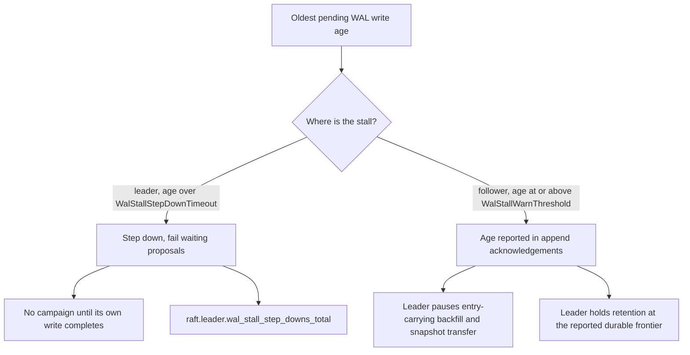

# WAL Diagnostics

Use the tools on this page when you suspect that storage limits your cluster, or when you must prove that a WAL change helps. The WAL is the write-ahead log. A write commits only after a quorum of replicas stores it in their WAL, so slow disks make slow writes.

The metrics and methods on this page answer these questions:

- Does the WAL scheduler combine many writes into few storage calls?
- Is the disk on one node slow or stalled?
- Does a leader give up leadership because its own disk does not answer?
- How many log entries does a partition keep, and how many can compaction remove?
- Does the RocksDB WAL share its memory budget correctly with your own RocksDB database?

The page also describes `syncWrites: false`, a switch that makes writes faster in tests and benchmarks. It is not safe for production.

## WAL Batch Metrics

The WAL scheduler reports its batches through these metrics:

- `raft.wal.batches_total`
- `raft.wal.operations_total`
- `raft.wal.batch_size`
- `raft.wal.write_duration_ms`
- `raft.wal.oldest_pending_write_age_ms`
- `raft.leader.wal_stall_step_downs_total`

`raft.wal.batches_total` counts the group writes from the scheduler to the storage adapter. One group write can include work from more than one partition.

`raft.wal.batch_size` records the number of operations that the scheduler drains for each partition inside a group write. It does not report the number of partitions in the group.

Under load, a healthy batch pattern usually shows a rise in `raft.wal.operations_total` that is faster than the rise in `raft.wal.batches_total`. That pattern means that the scheduler amortizes several WAL operations into fewer storage calls.

The scheduler also keeps internal counters. They are useful when you validate the WAL durability tuning:

- `TotalBatchesWritten`
- `TotalSyncBatchesWritten`
- `TotalPartitionsBatched`

`TotalSyncBatchesWritten` is the most direct signal for the single-fsync fast path. An fsync is a durable flush to disk. With `WalSingleFsyncCommit` disabled, a committed write usually causes sync work for the proposal and sync work for the commit. With the setting enabled, the scheduler can write a batch with committed markers only. That batch needs no sync of its own.

`TotalPartitionsBatched / TotalBatchesWritten` is useful when you tune `WalGroupCommitLingerMs`. The ratio must rise when the linger gathers more partitions into each group write.

## Durable-Write Stall Signals

`raft.wal.write_duration_ms` records how long each group WAL write spent inside the storage engine. `raft.wal.oldest_pending_write_age_ms` reports the age of the oldest accepted WAL operation per partition that has not completed yet. When the age keeps rising, the disk or storage engine is not answering, even if the node is still sending heartbeats.

On a leader, `WalStallStepDownTimeout` turns that local durable-write stall into a leadership decision. When the oldest pending local WAL write exceeds the timeout, the leader steps down, fails waiting proposals so callers can re-route, and refuses to campaign again until its own write completes. `raft.leader.wal_stall_step_downs_total` counts those demotions.

`WalStallWarnThreshold` controls warning logs and peer protection. Followers include their oldest pending WAL write age in append acknowledgements. While a peer reports a stall at or above that threshold, the leader pauses entry-carrying backfill and does not start snapshot transfer to that peer; neither can complete on a stalled disk. The leader also holds WAL retention at the peer's reported durable frontier within `CompactionLiveReplicaLagBudget`, so the follower can catch up from the log when its disk answers.



## Count The Persisted Logs And The Removable Logs

`IWAL` gives two helpful count methods:

- `CountPersistedLogs(partitionId)`
- `CountRemovableLogs(partitionId)`

`CountPersistedLogs` returns the total number of persisted log rows for the partition.

`CountRemovableLogs` returns the number of persisted rows strictly below the last committed checkpoint.

These methods are useful for:

- compaction diagnostics
- tests with a focus on the WAL
- an operational check that estimates the quantity of history that is still removable.

## Optional Non-Synchronous Writes

Both durable adapters support `syncWrites: false`:

```csharp
IWAL rocks = new RocksDbWAL("./data", "node-1", logger, syncWrites: false);
IWAL sqlite = new SqliteWAL("./data", "node-1", logger, syncWrites: false);
```

This setting can improve the throughput in CI, in a benchmark, and in some local test runs.

## Durability Tradeoff

With `syncWrites: false`, a process crash or a machine crash can lose an acknowledged write. Use the setting only when crash durability is not part of your validation.

For a production latency change that keeps quorum durability, prefer [WAL Commit Durability](./wal-commit-durability.md). Use the `WalSingleFsyncCommit` setting and the `WalGroupCommitLingerMs` setting. Do not disable the synchronous writes.

## Shared RocksDB Memory Checks

A host can pass `RocksDbSharedResources` to `RocksDbWAL`. Two resource counters then confirm the setup:

- `RocksDbSharedResources.MemtableMemoryUsage`
- `RocksDbSharedResources.BlockCache.GetUsage()`

`MemtableMemoryUsage` is the clearer signal for the write path. It must rise when any database that shares the write-buffer manager writes data.

`BlockCache.GetUsage()` applies to the read path. In a pure append workload, it can stay almost constant until reads fill the block cache.

See [Shared RocksDB Memory](./shared-rocksdb-memory.md) for ownership guidance and size guidance.

## RocksDB WAL Health Gauges

`RocksDbWAL` publishes observable gauges that show whether the storage engine is healthy under write load:

- `raft.wal.delayed_write_rate`
- `raft.wal.write_stalled`
- `raft.wal.shard_live_sst_bytes`
- `raft.wal.shard_l0_files`
- `raft.wal.shard_l6_files`
- `raft.wal.alive_log_bytes`
- `raft.wal.table_readers_memory`
- `raft.wal.memtable_memory`
- `raft.wal.block_cache_usage`
- `raft.wal.block_cache_pinned_usage`

`raft.wal.delayed_write_rate` is nonzero when RocksDB is throttling WAL writers. `raft.wal.write_stalled` is `1` when RocksDB has stopped writes entirely. Either signal means the storage engine is directly slowing Raft writes, so look at disk bandwidth, L0 file pressure, shared write-buffer budgets, and compaction settings before changing Raft timeouts.

`raft.wal.shard_live_sst_bytes` tracks live SST bytes across the Raft-log shard column families. It should roughly follow the retained log window. If it grows far beyond the data that checkpoints, retention holds, application durability floors, and live-replica holds should retain, compaction or whole-file reclamation is not keeping up.

`raft.wal.shard_l0_files` shows files waiting in L0. A climb toward the slowdown or stop trigger means RocksDB may start throttling writes. `raft.wal.shard_l6_files` helps identify old shard files that reached the bottom level and are still live.

`raft.wal.alive_log_bytes` tracks live RocksDB `.log` files for the Raft WAL engine. Linear growth under one hot shard and otherwise idle partitions usually means a trickle-write column family is pinning old RocksDB log files. Tune `RocksDbWalTuning.MaxTotalWalSizeFlushUnits` to bound that replay tail.

The native-memory gauges help explain process RSS that is not visible in the managed heap:

| Gauge | What It Means |
| --- | --- |
| `raft.wal.table_readers_memory` | Open table-reader memory across the WAL engine, including SST index/filter blocks. Without shared resources this can grow outside the cache budget. |
| `raft.wal.memtable_memory` | Memtable bytes across the WAL engine's column families, including immutable memtables waiting for flush. |
| `raft.wal.block_cache_usage` | Bytes resident in the block cache. With shared resources, this is the whole shared cache occupancy. |
| `raft.wal.block_cache_pinned_usage` | Bytes in the block cache that cannot currently be evicted. A value near the cache budget means reads can still hit disk even with a large cache. |

When you use `RocksDbSharedResources`, Kommander charges index and filter blocks to the shared block cache. That should keep `raft.wal.table_readers_memory` small and move that memory into `raft.wal.block_cache_usage`, where the shared budget can account for it.

If a shared `WriteBufferManager` is too small for the configured `RocksDbWalTuning` flush unit, the WAL can flush before short-lived entries and tombstones meet in memory. That raises write amplification. Increase the shared memtable budget, lower the shard flush unit, or accept the extra flush cost after measuring it.
