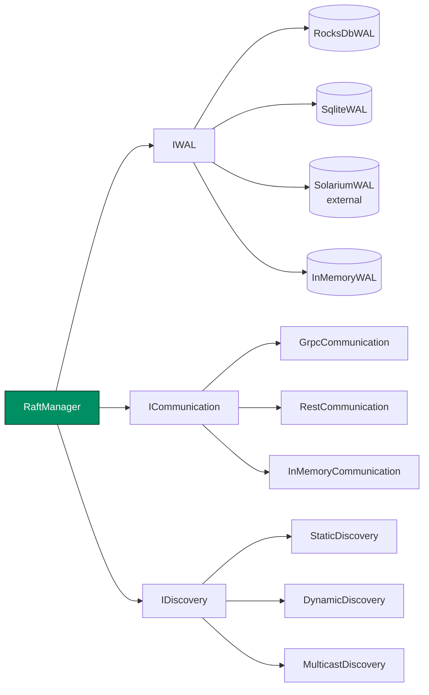

# Adapters

An adapter connects Kommander to one part of your environment. Kommander uses three kinds of adapter:

- A **WAL adapter** stores the Raft log. The WAL is the write-ahead log.
- A **communication adapter** carries Raft messages between the nodes.
- A **discovery adapter** tells a node where to find the other nodes.

You pick one of each when you [create a node](../guides/creating-a-node.md). Kommander keeps persistence, transport, and discovery pluggable, so you can use the storage and the network stack that your service already has. You can also write your own adapter.



Common choices:

| Situation | WAL | Communication | Discovery |
| --- | --- | --- | --- |
| Networked cluster | `RocksDbWAL`, `SqliteWAL`, or external `SolariumWAL` | `GrpcCommunication` or `RestCommunication` | `StaticDiscovery` |
| Tests and simulations | `InMemoryWAL` | `InMemoryCommunication` | `StaticDiscovery` or `DynamicDiscovery` |

## WAL Adapters

| Adapter | Use case |
| --- | --- |
| `RocksDbWAL` | Durable production-oriented storage backed by RocksDB. |
| `SqliteWAL` | Durable embedded storage backed by SQLite. |
| `SolariumWAL` | External durable adapter supplied by `Solarium.Kommander`. Implemented in .NET without the native RocksDB library. |
| `InMemoryWAL` | Tests and simulations only. Data is lost when the process exits. |

```csharp
IWAL rocks = new RocksDbWAL("./data", "node-1", logger);
IWAL sqlite = new SqliteWAL("./data", "node-1", logger);
IWAL memory = new InMemoryWAL(logger);
```

`SolariumWAL` is maintained outside the Kommander repository. It implements the same `IWAL` contract and is passed directly to `RaftManager`:

```csharp
using Solarium.Kommander;

IWAL solarium = new SolariumWAL(
    "/var/lib/node1/raft",
    "v1",
    logger,
    syncWrites: true
);
```

Its data directory is not compatible with a `RocksDbWAL` directory, even though both adapters expose the same logical Raft behavior. See [Solarium WAL](../operations/solarium-wal.md) for setup, durability, metrics, migration cautions, and tuning ownership.

### RocksDB Shared Memory Resources

Hosts that also open their own RocksDB database can share RocksDB memory resources with Kommander's `RocksDbWAL`.

```csharp
using Kommander.WAL;

RocksDbSharedResources shared = RocksDbSharedResources.CreateWithUnifiedBudget(
    totalBytes: 512L * 1024 * 1024,
    memtableBudgetBytes: 128L * 1024 * 1024
);

IWAL rocks = new RocksDbWAL(
    path: "./data",
    revision: "node-1",
    logger: logger,
    syncWrites: true,
    sharedResources: shared
);
```

The bundle contains one shared RocksDB block cache and one shared write-buffer manager. `RocksDbWAL` borrows the bundle; the host owns it and disposes it after all databases that use it have closed.

There is no `RaftConfiguration` flag for this. Sharing is configured by passing `sharedResources` to the `RocksDbWAL` constructor and wiring the same cache/write-buffer manager into the host application's own RocksDB options before opening that database.

See [Shared RocksDB Memory](../operations/shared-rocksdb-memory.md) for sizing, ownership, and observability guidance.

### RocksDB WAL Tuning

`RocksDbWAL` also accepts a `RocksDbWalTuning` object for deployments with unusual log rates, many hot partitions, or a tight shared RocksDB memory budget:

```csharp
IWAL rocks = new RocksDbWAL(
    path: "./data",
    revision: "node-1",
    logger: logger,
    syncWrites: true,
    tuning: RocksDbWalTuning.Default
);
```

The defaults are designed for append-heavy Raft logs whose dead prefix is deleted logically and then reclaimed as whole SST files.

| Property | Default | Description |
| --- | ---: | --- |
| `ShardWriteBufferSizeBytes` | `64 MiB` | Size of one Raft-log shard column-family memtable. |
| `ShardMinWriteBufferNumberToMerge` | `2` | Immutable memtables merged into one flush. This widens the window where short-lived log rows and their tombstones can die before reaching disk. |
| `ShardMaxWriteBufferNumber` | `4` | Maximum mutable plus immutable memtables per shard column family. Must be greater than `ShardMinWriteBufferNumberToMerge`. |
| `ShardLevel0FileNumCompactionTrigger` | `8` | L0 file count that triggers movement toward the base level. Under the floor layout, non-overlapping partition files usually move without rewriting rows. |
| `ShardLevel0SlowdownWritesTrigger` | `28` | L0 file count where RocksDB begins slowing writers. |
| `ShardLevel0StopWritesTrigger` | `44` | L0 file count where RocksDB stops writers. |
| `MaxTotalWalSizeFlushUnits` | `2` | Bound for live RocksDB `.log` files, measured in shard flush units. Keeps idle or trickle-write column families from pinning an unbounded WAL replay tail. `0` leaves RocksDB's default. |
| `ShardMaxBytesForLevelBase` | `0` | Optional RocksDB `max_bytes_for_level_base` override for shard column families. `0` leaves the RocksDB default. |
| `ShardUniversalCompaction` | `false` | Uses universal compaction for shard column families instead of the shipped leveled layout. |

When you share a `WriteBufferManager`, size its budget for at least the Raft WAL flush unit plus the host database's own memtables. The flush unit is `ShardWriteBufferSizeBytes * ShardMinWriteBufferNumberToMerge`; the writer also needs one additional mutable memtable of headroom. If the shared budget is too small, RocksDB flushes early and write amplification rises even though safety is unchanged.

`MaxTotalWalSizeFlushUnits` applies to the RocksDB engine's own write-ahead `.log` files, not to Raft log entries. RocksDB can only delete a `.log` file after every column family with data in that file has flushed. The cap lets RocksDB flush the small pinning column families before restart replay grows without bound, while busy shard column families continue to flush on their normal Raft-log cadence.

`SqliteWAL` uses a fixed pool of SQLite shard databases. Partitions map to shards with `partitionId mod shardCount`, so `FairWalScheduler` group batches can be committed as one transaction per shard instead of one transaction per partition.

You can choose the shard count for a fresh WAL directory:

```csharp
IWAL sqlite = new SqliteWAL(
    path: "./data",
    revision: "node-1",
    logger: logger,
    syncWrites: true,
    shardCount: 4
);
```

Use fewer shards when write batching and fsync reduction matter most. Use more shards when independent SQLite shard concurrency matters more. The shard count is persisted the first time the directory is initialized; changing it later would remap partitions, so reopening an existing directory with a different non-zero shard count fails fast.

Both durable adapters also support `syncWrites: false` for benchmarks and some CI scenarios:

```csharp
IWAL fastRocks = new RocksDbWAL("./data", "node-1", logger, syncWrites: false);
IWAL fastSqlite = new SqliteWAL("./data", "node-1", logger, syncWrites: false);
```

With `syncWrites: false`, acknowledged writes may still be lost on process or machine crash. Use that mode only when crash durability is not part of what you are validating.

Custom adapters implement `IWAL`.

```csharp
public interface IWAL : IDisposable
{
    List<RaftLog> ReadLogs(int partitionId);
    List<RaftLog> ReadLogsRange(int partitionId, long startLogIndex, int maxEntries = int.MaxValue);
    List<RaftLog> ReadLogsRange(int partitionId, long startLogIndex, int maxEntries, long maxBytes);
    long GetTermAt(int partitionId, long logIndex);
    RaftOperationStatus Write(List<(int partitionId, List<RaftLog> logs)> logs);
    RaftOperationStatus Write(List<(int partitionId, List<RaftLog> logs)> logs, bool sync);
    long GetMaxLog(int partitionId);
    long GetCurrentTerm(int partitionId);
    long GetLastCheckpoint(int partitionId);
    int CountPersistedLogs(int partitionId);
    int CountRemovableLogs(int partitionId);
    string? GetMetaData(string key);
    bool SetMetaData(string key, string value);
    bool PersistHardState(int partitionId, long currentTerm, string? votedFor);
    bool TryGetHardState(int partitionId, out long currentTerm, out string? votedFor);
    bool PersistHlcFloor(int partitionId, long floorL);
    long GetHlcFloor(int partitionId);
    (RaftOperationStatus Status, int Removed) CompactLogsOlderThan(
        int partitionId,
        long lastCheckpoint,
        int compactNumberEntries,
        int? maxTotalEntries = null
    );
    RaftOperationStatus DeletePartitionWAL(int partitionId);
    RaftOperationStatus TruncateLogsAfter(int partitionId, long afterLogId);
    (RaftOperationStatus Status, long MaxLogId) TruncateLogsAfterAndGetMax(int partitionId, long afterLogId);
    RaftOperationStatus TruncateProposedLogsAfter(int partitionId, long afterLogId);
    (RaftOperationStatus Status, bool SuffixTruncated) InstallSnapshotBoundary(
        int partitionId,
        long snapshotIndex,
        long lastIncludedTerm
    );
}
```

Several methods have default implementations in the source interface to keep simple test adapters compatible:

- `ReadLogsRange(..., maxBytes)` can delegate to the entry-count overload, but durable adapters should enforce the byte cap during the scan so backfill does not materialize oversized batches.
- `Write(..., sync)` can delegate to `Write(...)`; durable adapters should honor `sync: false` for commit-marker batches used by the single-fsync fast path.
- `GetTermAt` can use `ReadLogsRange`, but durable adapters should implement a scalar lookup so log-matching checks do not read payloads.
- `PersistHardState` and `TryGetHardState` use metadata keys by default. Durable adapters must make `SetMetaData` return `false` on storage failure instead of throwing, because election code will not solicit votes or grant a vote that it could not record.
- `PersistHlcFloor` and `GetHlcFloor` use metadata keys by default. Durable adapters should persist this floor with the same crash-safety expectations as hard state metadata. On restore, Kommander merges the floor into the local hybrid logical clock before it can mint new proposal timestamps.

The counting methods are useful for tests, diagnostics, and compaction visibility:

- `CountPersistedLogs`: total persisted log rows for the partition.
- `CountRemovableLogs`: persisted rows strictly below the last committed checkpoint.

## Communication Adapters

| Adapter | Use case |
| --- | --- |
| `GrpcCommunication` | Networked clusters using gRPC streaming. |
| `RestCommunication` | Networked clusters using REST/JSON endpoints. |
| `InMemoryCommunication` | Unit tests and in-process simulations. |

Outbound Raft transport messages can be batched through `BatchRequests`. That includes append traffic and control traffic such as step-down notices and leadership-transfer requests.

`RestCommunication` uses source-generated `System.Text.Json` metadata for its Raft request and response bodies. This keeps the REST wire shape stable while supporting trimmed hosts that disable reflection-based JSON. If you build a custom REST host or add new REST message types, make sure every request and response type is present in the generated JSON context; one missing type can make the host fail when ASP.NET Core builds the endpoints.

The browser/thread-free build keeps the REST client, but leaves out server transports and the gRPC client. See [Thread-Free Embedded Mode](../guides/thread-free-embedded-mode.md) for the browser target limits.

Custom transports implement `ICommunication`.

At minimum, production transports should cover:

- core Raft RPCs: `Handshake`, `RequestVotes`, `Vote`, `AppendLogs`, `CompleteAppendLogs`, `BatchRequests`
- dynamic membership RPCs: `SendJoin`, `SendLeave`
- SWIM liveness RPCs: `SendPing`, `SendPingReq`
- learner and backfill support: `GetRemoteFollowerLag`, `SendInstallSnapshot`
- optional membership anti-entropy: `SendGossip`
- join failure notification: `NotifyJoinBlocked`.

Some methods have default no-op or failure-returning implementations, but relying on those defaults disables the corresponding runtime behavior.

`InMemoryCommunication` includes fault-injection controls for tests and simulations:

- `PartitionNode(endpoint)` drops all traffic to and from one endpoint
- `HealPartition(endpoint)` restores traffic for a node partition
- `BlockLink(from, to)` drops only one directed link
- `UnblockLink(from, to)` restores one directed link
- `BlockLinkBothWays(a, b)` and `UnblockLinkBothWays(a, b)` model a pairwise network cut
- `HealAll()` removes every node and link filter.

Directional link blocks are useful for testing asymmetric networks. A request can reach a peer while the reply is lost, which models failures such as a snapshot install that succeeds on the receiver while the sender observes a failed transfer.

### Dynamic Membership Support

Practical state today:

- membership roster commits and join flow work on `InMemoryCommunication`, `GrpcCommunication`, and `RestCommunication`
- graceful leave RPCs are wired on `InMemoryCommunication`, `GrpcCommunication`, and `RestCommunication`
- cross-partition remote lag lookup for learner promotion is wired on `InMemoryCommunication`, `GrpcCommunication`, and `RestCommunication`
- SWIM direct and indirect ping probing is wired on `InMemoryCommunication`, `GrpcCommunication`, and `RestCommunication`
- gossip anti-entropy and leader-balancer load reports are wired on `InMemoryCommunication`, `GrpcCommunication`, and `RestCommunication`.

That means:

- gRPC and REST can still run membership commits and joins through Raft replication
- gRPC and REST can use graceful leave through their transport RPCs
- gRPC and REST can use remote follower lag lookups for learner promotion
- gRPC and REST can use SWIM probing and partition quiescence
- gRPC and REST can exchange membership gossip and leader-balancer load reports.

## Discovery Adapters

| Adapter | Use case |
| --- | --- |
| `StaticDiscovery` | Fixed seed/contact list. Useful for bootstrap, not as the live membership authority. |
| `DynamicDiscovery` | Mutable in-memory contact list controlled by the application. Useful for tests and programmatic bootstrap. |
| `MulticastDiscovery` | UDP multicast discovery on local networks. |

`RedisDiscovery` is present in source as a placeholder and returns no nodes in this release. Do not use it for cluster formation.

Custom discovery providers implement `IDiscovery`:

```csharp
public interface IDiscovery
{
    Task Register(RaftConfiguration configuration);
    List<RaftNode> GetNodes();
}
```

With dynamic membership enabled, discovery helps nodes find contact points. The committed roster on partition `0` remains the source of truth for who actually belongs to the cluster and who counts toward quorum.
