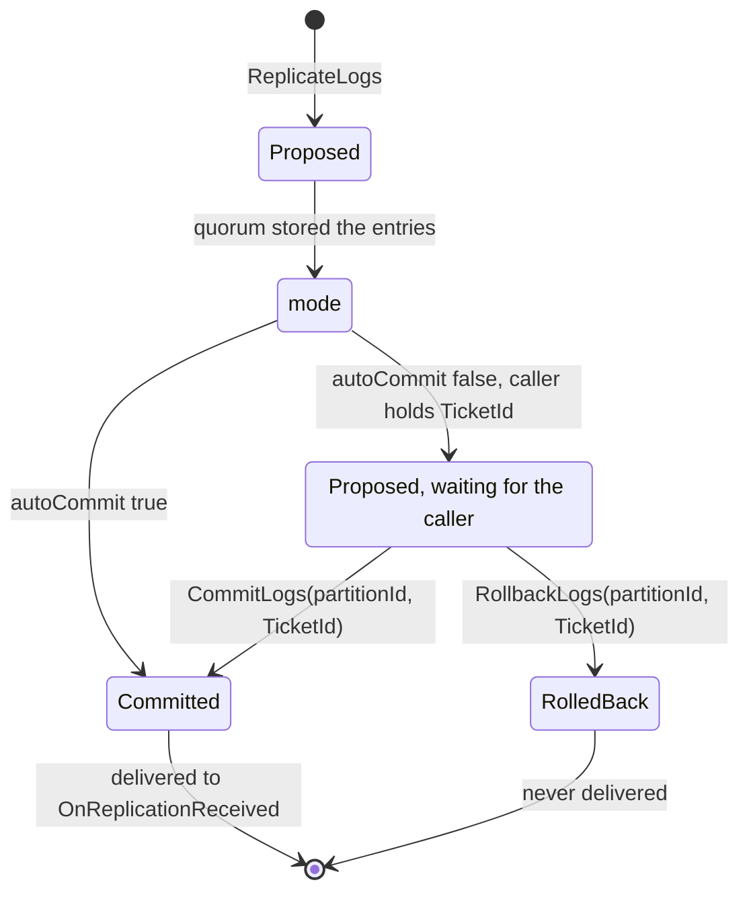

# IRaft API

`IRaft` is the interface that your application uses to work with Kommander. `RaftManager` implements it. Use this page to find a member and to check its exact behavior: its parameters, its return values, and its status values.

You do not need most of these members to start. A basic service uses five: `OnLogRestored` and `OnReplicationReceived` to apply entries, `JoinCluster` to start, `ReplicateLogs` to write, and `LeaveCluster` to stop. The guides explain the other members in context. For example, read [Elastic Partitions](../guides/elastic-partitions.md) before you use the partition APIs.

The table groups the members by area.

| Area | Members |
| --- | --- |
| Lifecycle | `JoinCluster`, `LeaveCluster`, `RequestLeaveAsync`, `UpdateNodes` |
| Membership | `GetMembership`, `LocalRole`, `OnMembershipChanged` |
| Cluster state | `Joined`, `IsInitialized`, `GetNodes`, `GetLocalEndpoint`, `GetLocalNodeId`, `GetLocalNodeName`, `GetLastNodeActivity`, `GetActiveNodes`, `GetCommitIndex`, `GetFollowerLagAsync`, `GetFollowerProgress`, `GetSnapshotStatuses`, `GetBackfillStatuses` |
| Leadership | `AmILeaderQuick`, `AmILeader`, `ConfirmLeadershipAsync`, `ConfirmLocalApplicationAsync`, `SetCandidacyWithheld`, `IsCandidacyWithheld`, `WaitForLeader`, `WaitForLeaderStableAsync` |
| Replication | `ReplicateLogs`, `ReplicateEntries`, `ReplicateCheckpoint`, `CommitLogs`, `RollbackLogs`, `RequestReseedAsync` |
| Elastic partitions | `CreatePartitionAsync`, `RemovePartitionAsync`, `SplitPartitionAsync`, `MergePartitionsAsync`, `GetNextAvailablePartitionId`, `GetPartitionGeneration`, `GetPartitionMap`, `GetPartitionReplicas`, `GetEffectiveReplicationFactor`, `SetReplicationFactorAsync`, `RegisterStateMachineTransfer` |
| System partition state | `RegisterSystemStateTransfer`, `SetMinRetainIndex`, `AcquireRetentionHold` |
| User partition state | `RegisterPartitionStateTransfer` |
| Partition load | `GetPartitionLogOpsPerSecond`, `GetPartitionWalQueueDepth`, `GetPartitionCommitWaitMs` |
| Diagnostics | `GetStaleProposedSkippedCount`, `GetSnapshotStatuses`, `GetBackfillStatuses` |
| Partition routing | `GetPartitionKey`, `GetPrefixPartitionKey` |
| Transport entry points | `Handshake`, `RequestVote`, `Vote`, `AppendLogs`, `CompleteAppendLogs` |
| Components | `WalAdapter`, `Communication`, `Discovery`, `Configuration`, `HybridLogicalClock`, `ReadScheduler`, `WalScheduler` |
| Events | `OnRestoreStarted`, `OnRestoreFinished`, `OnReplicationError`, `OnLogRestored`, `OnReplicationReceived`, `OnLeaderChanged`, `OnPartitionMapChanged` |

The transport entry points are intended for communication adapters and HTTP/gRPC endpoint handlers. Normal application writes should use the replication APIs.

`RaftManager` also exposes system-partition callbacks on the concrete type for internal configuration replication. They are not part of `IRaft`.

## Lifecycle Notes

`JoinCluster` accepts an optional cancellation token:

```csharp
using CancellationTokenSource joinTimeout = new(TimeSpan.FromSeconds(30));
await raft.JoinCluster(joinTimeout.Token);
```

If you do not supply your own cancellation, `RaftManager` still applies an internal 60-second timeout while waiting for cluster initialization to complete.

There is also a seed-based overload:

```csharp
await raft.JoinCluster(
    new[] { "node-a:7000", "node-b:7000" },
    joinTimeout.Token
);
```

The join flow adds new nodes as learners first and only returns once the node has been promoted to a committed voter.

Use `RequestLeaveAsync` when you want the cluster removal result without automatically stopping the process:

```csharp
LeaveClusterResult leave = await raft.RequestLeaveAsync(cancellationToken);

if (leave.Left)
    await raft.LeaveCluster(dispose: true, cancellationToken);
```

`RequestLeaveAsync` commits `RemoveMember(self)` when it can and returns a `LeaveClusterResult` with the outcome and membership version. It is useful for decommissioning workflows because a refused or timed-out attempt leaves the node running as a normal participant. `LeaveCluster(...)` is the shutdown-coupled helper; it tries the graceful removal and then stops the node.

Possible outcomes are `Committed`, `NotAMember`, `RefusedInsufficientVoters`, `NotInitialized`, `NoLeader`, `Timeout`, `RefusedDrainInProgress`, and `DrainTimedOut`. `LeaveClusterResult.Left` is true for `Committed` and `NotAMember`; `Terminal` is true for `RefusedInsufficientVoters`. `LeaveClusterResult.Drained` tells whether replica placement evacuated every range that named this node before the final removal.

## Membership

`GetMembership` returns a point-in-time snapshot of the committed cluster roster.

`LocalRole` tells you whether the local node is currently a:

- `Voter`
- `Learner`
- `Leaving`
- `NotMember`

```csharp
ClusterMembership roster = raft.GetMembership();
ClusterMemberRole localRole = raft.LocalRole;
```

Use `OnMembershipChanged` to observe roster version changes:

```csharp
raft.OnMembershipChanged += membership =>
{
};
```

`MembershipVersion` is monotonic for the life of the cluster and is the main fence for membership updates.

## Cluster Activity

`GetLastNodeActivity` returns the last HLC timestamp when the local node observed activity from a specific endpoint.

`GetActiveNodes` returns non-local endpoints seen within a time window. This is useful for diagnostics, health displays, and tests that need to confirm recent follower activity.

```csharp
HLCTimestamp lastSeen = raft.GetLastNodeActivity("node-b:2070");
IReadOnlyList<string> activeNodes = raft.GetActiveNodes(TimeSpan.FromSeconds(2));
```

`GetFollowerLagAsync` returns the observed lag for a follower on a partition when the local node has that progress information:

```csharp
long? lag = await raft.GetFollowerLagAsync(
    partitionId: 1,
    followerEndpoint: "node-b:2070"
);
```

`null` means there is no recorded lag value for that follower and partition on this node.

`GetFollowerProgress` returns a richer leader-side snapshot of what the leader last heard from a follower:

```csharp
RaftFollowerProgress? progress = raft.GetFollowerProgress(
    partitionId: 1,
    followerEndpoint: "node-b:2070"
);

if (progress is { WalStalled: true })
{
    logger.LogWarning(
        "Follower {Endpoint} is {Entries} durable entries behind and has waited {WaitMs} ms for WAL",
        progress.Endpoint,
        progress.EntriesBehind(progress.LeaderCommitIndex),
        progress.WalStallMs
    );
}
```

Use this when an application-level protocol may wait on a follower and needs to know whether that follower can answer. `DurableFrontier` is the highest committed index the follower says is written to its disk. `ProtocolFrontier` is the higher protocol frontier that may advance while a WAL write is still pending. During a follower disk stall, the protocol frontier can keep rising while the durable frontier stands still.

`null` means unknown, not caught up. Only the current leader records follower progress, and a leader reports `null` until the current leadership has folded an acknowledgement from that peer.

`GetCommitIndex(partitionId)` returns the highest gap-free log id that is known committed and durable on the local node. It returns `-1` when the partition is not hosted locally or nothing has committed. The value excludes proposed-but-uncommitted entries and entries above a hole. It also waits for local WAL durability before publishing a higher value, so an observer never sees a commit index that the local disk later refused. Within one process lifetime the published value does not decrease; after a crash, it can restart lower until the leader re-supplies lazy commit markers or catch-up data.

Leader-side catch-up diagnostics are available through:

```csharp
IReadOnlyList<RaftSnapshotStatus> snapshot =
    raft.GetSnapshotStatuses(partitionId: 1);

IReadOnlyList<RaftBackfillStatus> backfill =
    raft.GetBackfillStatuses(partitionId: 1);
```

`GetSnapshotStatuses` reports followers that are stuck in snapshot transfer, including failed attempts, in-flight duration, retry backoff, and last error details. It also reports `RescueNotConverging` and `ConsecutiveRescueCycles` when repeated successful installs leave the follower below the compaction floor and the leader trips the snapshot-rescue breaker. `GetBackfillStatuses` reports followers whose anchored backfill batch cannot be sent because the leader has no committed entry at the follower's anchor. Both are diagnostic views; empty means the partition is not hosted here, this node is not the relevant leader/sender, or no follower is currently stuck.

`GetStaleProposedSkippedCount(partitionId)` returns how many stale proposed duplicates this node refused for that hosted partition since it last started. It returns `-1` when the partition is not hosted locally. Treat the value as a diagnostic floor, not a lifetime total.

## Partition Load Signals

Use the partition-load accessors to observe leader-side replicated-log throughput and WAL saturation:

```csharp
double rate = raft.GetPartitionLogOpsPerSecond(partitionId);
int depth = raft.GetPartitionWalQueueDepth(partitionId);
double waitMs = raft.GetPartitionCommitWaitMs(partitionId);
```

The local leader reads live in-process values. Other nodes read the latest gossiped leader report, which requires `EnableLeaderBalancer = true` and can lag by one report interval plus propagation time.

All three methods return `0` for an unknown partition or when no leader report is available. `CommitWaitMs` retains its last value while idle, so use it with a nonzero log rate rather than as a standalone trigger.

See [Partition Load Signals](../guides/partition-load-signals.md) for signal semantics and split-trigger guidance.

## Replication APIs

Use `ReplicateLogs` when every payload in the call shares one type, one `autoCommit` value, and one generation fence.

With `autoCommit: false`, the returned `TicketId` decides the outcome of the proposal through `CommitLogs` or `RollbackLogs`:



`ReplicateLogs` also accepts `expectedTerm`. This is a local-leadership term fence for callers that made a decision based on this node's current term. If the term no longer matches, Kommander refuses the write before appending anything and returns `RaftOperationStatus.TermMismatch`. Re-read `GetPartitionTerm(partitionId)` and decide again instead of blindly retrying the same command on another replica.

Use `ReplicateEntries` when a consumer has a mixed batch of per-entry-typed writes for one partition:

```csharp
RaftBatchReplicationResult result = await raft.ReplicateEntries(
    partitionId: 1,
    entries:
    [
        new RaftProposalEntry("kv", keyValueBytes),
        new RaftProposalEntry("lock", lockBytes),
        new RaftProposalEntry("receipt", receiptBytes),
    ],
    cancellationToken: cancellationToken
);
```

`ReplicateEntries` returns one `RaftEntryResult` per input entry, index-aligned to the input list. It supports a leading auto-commit group plus one optional trailing manual group. Per-entry `ExpectedGeneration` fences let stale entries return `PartitionMoved` without necessarily failing their siblings.

See [Heterogeneous Write Coalescing](../guides/heterogeneous-write-coalescing.md) for the full result contract and batching rules.

## Events

Subscribe before `JoinCluster` if you need restore callbacks.

```csharp
raft.OnRestoreStarted += partitionId => { };
raft.OnRestoreFinished += partitionId => { };

raft.OnLogRestored += (partitionId, log) =>
{
    return Task.FromResult(true);
};

raft.OnReplicationReceived += (partitionId, log) =>
{
    return Task.FromResult(true);
};

raft.OnReplicationError += (partitionId, log) => { };

raft.OnLeaderChanged += (partitionId, leaderEndpoint) =>
{
    return Task.FromResult(true);
};

raft.OnPartitionMapChanged += ranges =>
{
};

raft.OnMembershipChanged += membership =>
{
};
```

## Leadership Helpers

Use `WaitForLeader` when you need the current leader endpoint before routing a request. Use `WaitForLeaderStableAsync` when you need the same non-empty leader to remain stable for a minimum duration.

```csharp
string leader = await raft.WaitForLeader(1, cancellationToken);

string stableLeader = await raft.WaitForLeaderStableAsync(
    1,
    TimeSpan.FromMilliseconds(500),
    cancellationToken
);
```

`WaitForLeader` waits for the partition restore task to complete before starting its election wait. That means a large WAL restore is bounded by your cancellation token, not by the fixed leader-election polling budget. If restore fails, the method throws a `RaftException` that wraps the underlying restore failure.

`WaitForLeaderStableAsync` is especially useful in tests and operational flows where you want to avoid reacting to a leader that is still flapping.

Prefer the overload that includes an overall timeout when you want a bounded wait:

```csharp
string stableLeader = await raft.WaitForLeaderStableAsync(
    partitionId: 1,
    minStableFor: TimeSpan.FromMilliseconds(500),
    timeout: TimeSpan.FromSeconds(10),
    cancellationToken: cancellationToken
);
```

The overload without `timeout` treats `minStableFor` as a required stability window, not a deadline. It can wait indefinitely if leadership keeps changing and the cancellation token is not cancelled.

Use `ConfirmLeadershipAsync` before serving authoritative reads from local leader-owned state:

```csharp
if (!await raft.ConfirmLeadershipAsync(partitionId, cancellationToken))
    throw new InvalidOperationException("Leadership could not be confirmed; retry or redirect.");

OrderView order = localProjection.Get(orderId);
```

`AmILeaderQuick` and `AmILeader` report local leadership belief. They are useful for routing hints and quick checks, but a minority-partitioned leader can continue believing it is leader until it observes a higher term. `ConfirmLeadershipAsync` performs a same-term quorum acknowledgement round and waits until the local applied frontier covers the confirmed commit index. A read served after a `true` result is linearizable with respect to committed writes.

Concurrent confirmations coalesce into one in-flight round, and a fresh confirmation can be reused within the heartbeat interval. A `false` result means the node is not the published leader, quorum could not be confirmed within `LeadershipConfirmationTimeout`, apply catch-up did not finish in time, or admission control rejected the request.

When application delivery trails the confirmed commit index, each caller waits for its own required applied index. Callers for the same index share the wait, and unrelated intermediate applies do not repeatedly wake them. A role change, term change, or lease invalidation releases parked confirmations immediately so a demoted node returns `false` instead of waiting for the full confirmation timeout.

Use `ConfirmLocalApplicationAsync` when a local non-leader must prove its applied state has caught up before acting on it:

```csharp
if (!await raft.ConfirmLocalApplicationAsync(partitionId, cancellationToken))
    return;

await localMaintenance.PruneFilesReferencedByReplicatedState(cancellationToken);
```

This is the follower-side read-index primitive. It asks the leader to confirm a same-term commit index, then waits until this node has applied through that index. It returns `false` for every unsafe or unavailable case, including no known leader, quorum confirmation failure, restore in progress, not-hosted partitions under replica placement, transport errors, timeout, or admission rejection. Entries committed after the call starts may or may not be visible, which matches normal read-index freshness.

Concurrent follower confirmations for the same partition and believed leader are coalesced before the remote `GetReadIndex` call is sent. A quiet follower adds no extra round trip; under a burst, several calls can share one leader fetch. A call never joins a fetch that is already on the wire, so every returned read index is captured after that call arrived.

## Reseed And Candidacy Control

Use `RequestReseedAsync` when the local application projection for a partition is missing or untrusted even though Raft log catch-up may look complete:

```csharp
raft.SetCandidacyWithheld(partitionId, withheld: true);

RaftOperationStatus status =
    await raft.RequestReseedAsync(partitionId, cancellationToken);
```

The call is made on the replica that needs repair. It holds committed application delivery, asks the current leader for a fresh checkpoint, and waits for the leader to ship a forced snapshot. The receiver imports that snapshot even if the existing WAL boundary already appears to cover the snapshot index, because reseed is about repairing the application state.

`RequestReseedAsync` returns:

- `Success` when the request was accepted locally and sent, or when a reseed request is already pending
- `NodeIsNotLeader` when the local node is the leader for that partition, because a leader cannot reseed itself from another leader
- `Errored` when the local node does not host the partition or no leader is currently known.

`SetCandidacyWithheld(partitionId, true)` keeps the repaired replica from becoming leader while its application state is suspect. It still votes, replicates, acknowledges, and participates as a follower. It also ignores leadership-transfer suggestions targeted at it. `IsCandidacyWithheld(partitionId)` reports the local flag.

Clear the flag after the application confirms that the imported state is healthy:

```csharp
raft.SetCandidacyWithheld(partitionId, withheld: false);
```

The reseed hold is bounded by `ReseedRequestTimeout`. If it expires, committed delivery resumes and the replica may request reseed again.

## Test Hooks

`IRaft` exposes several advanced members marked with `EditorBrowsable(EditorBrowsableState.Never)`:

- `ForceLeaderForTestingAsync`
- `StepDownAsync`
- `TransferLeadershipAsync`
- `SuspendHeartbeatsAsync`
- `ResumeHeartbeatsAsync`
- `HoldCommittedProposalRepliesForTesting`
- `SetSnapshotInstallGateForTesting`
- `HoldConsumerAppliesForTesting`
- `ResumeConsumerAppliesForTesting`

These are intended for deterministic tests and fault-injection scenarios, not ordinary application traffic or public API endpoints.

`HoldCommittedProposalRepliesForTesting(partitionId, onHeld)` intercepts only the caller reply for a successful committed proposal. The entry is already durable on a quorum, the leader has advanced its commit frontier, commit-marker fan-out can continue, and followers can still apply it. The `HeldProposalReply` gives the partition id, ticket id, commit index, term, log ids, and the success site. A test can call `Release()` to complete the waiter or `Drop()` to make the caller observe the same indeterminate timeout shape as a leader that died after quorum durability but before answering.

`SetSnapshotInstallGateForTesting(partitionId, phase, gate)` suspends a follower-side snapshot install at a named phase: `BeforeImport`, `AfterImport`, or `AfterBoundary`. The gate receives a read-only `SnapshotInstallSignal` with the snapshot index, boundary term, snapshot kind, phase, local max log id, and last applied index. The gate runs inline on the partition executor and is bounded by `LeadershipBarrierTimeout`; expiry fails the install and normal retry can continue.

`HoldConsumerAppliesForTesting(partitionId)` pauses delivery of committed entries to the local consumer while replication, acknowledgements, elections, and the commit frontier continue. It holds the applied cursor honestly, so read-index confirmation, compaction fences, and backfill progress do not claim consumer progress that did not happen. `ResumeConsumerAppliesForTesting(partitionId)` drains the pending committed entries in log order. These hooks are useful for deterministic replay and crash-window tests.

## User Partition State

Register `IRaftPartitionStateTransfer` on every node that can host or lead a user partition:

```csharp
raft.RegisterPartitionStateTransfer(new OrderStoreTransfer(store));
```

The transfer lets Kommander repair a replica of a user partition that is below the compaction floor. The leader exports the whole application state of the partition, and the follower imports it. Without this transfer, Kommander falls back to `IRaftStateMachineTransfer.ExportRange` for the whole range. Registration is local process state and is not replicated. You can register it before `JoinCluster`.

In a mixed-version cluster, do not register it until every node supports the `PartitionState` snapshot kind. See [Snapshot Installation](../operations/snapshot-installation.md#implement-the-partition-state-transfer) for the full contract.

## System Partition State

Partition `0` can carry application-owned cluster-wide control state under application log types. The `_RaftSystem` log type is reserved for Kommander's own metadata and must not be used by application writes.

When application entries on partition `0` are deltas instead of full snapshots, register `IRaftSystemStateTransfer` on every node:

```csharp
raft.RegisterSystemStateTransfer(new ControlStateTransfer(store));
```

The transfer lets Kommander repair a node that has fallen below the partition `0` compaction floor by exporting and importing the whole application state. Registration is local process state and is not replicated.

Use `SetMinRetainIndex(0, snapshotIndex + 1)` after your application persists a local snapshot. This protects the unsnapshotted WAL tail from compaction for offline restart replay. The retain floor is in-memory and must be reasserted after restart.

Use `AcquireRetentionHold(partitionId, index)` when multiple independent consumers need temporary retention at the same time:

```csharp
using IDisposable hold = raft.AcquireRetentionHold(
    partitionId: 0,
    index: snapshotIndex + 1
);

await backup.CopyRetainedTailAsync(cancellationToken);
```

Unlike `SetMinRetainIndex`, retention holds compose. Kommander retains down to the minimum active hold index, and disposing a handle releases exactly that hold. A hold is synchronous, local to the process, idempotent on dispose, and resets on restart.

See [System Partition State Snapshots](../guides/system-partition-state-snapshots.md) for the full contract.

## Operation Status Values

| Status | Meaning |
| --- | --- |
| `Success` | Operation completed successfully. |
| `Errored` | Operation failed with an internal error. |
| `NodeIsNotLeader` | The local node is not leader for the requested partition. |
| `LeaderInOldTerm` | A request came from a leader with an old term. |
| `LeaderAlreadyElected` | A leader was already known for the term. |
| `LogsFromAnotherLeader` | A follower received logs from a node other than the expected leader. |
| `ActiveProposal` | Another proposal is still active. |
| `ProposalNotFound` | The supplied proposal ticket was not found. |
| `ProposalTimeout` | The proposal did not complete in time. |
| `ReplicationFailed` | Replication failed before commit. |
| `Pending` | Internal state used while asynchronous work is in progress. |
| `ProposalQueueFull` | The per-partition client proposal queue is full. Retry with backoff. |
| `RestoreInProgress` | The partition is still restoring from the WAL. Retry after a short delay. |
| `PartitionMoved` | The partition generation changed. Refresh the partition map and retry on the current owner. |
| `StaleMembership` | The roster version changed. Re-read membership and retry against the current version. |
| `ConcurrentMembershipChange` | Another membership change is already in flight. Retry after it commits. |
| `InsufficientVoters` | The requested removal would leave the cluster unavailable. Do not retry blindly. |
| `LogMismatch` | A follower rejected an anchored backfill append because its log did not match `PrevLogIndex` / `PrevLogTerm`. The leader backs up and retries. |
| `SnapshotRequired` | Reserved for wire compatibility. The runtime uses snapshot fallback internally and exposes stuck transfer state through `GetSnapshotStatuses`. |
| `OperationCancelled` | The caller's cancellation token fired before the operation completed. The queued work may still apply. |
| `FollowerWalSaturated` | A follower could not enqueue replicated entries because its WAL queue was saturated. The leader backs off and retries later. |
| `MemberNotFound` | A membership operation named an endpoint not present in the committed roster. |
| `DrainInProgress` | A second decommission drain was refused because another member is already `Leaving`. |
| `ProposalOutcomeUnknown` | The node accepted the proposal, but leadership moved or the completion arrived after step-down before this node could determine the final outcome. Treat it like `ProposalTimeout`: the write may still commit, so retry only with application-level idempotency or after reading the replicated state. |
| `TargetNotCaughtUp` | A leadership-transfer target did not catch up to the leader's last index within the bounded wait. The leader resumed serving. The caller may retry later. |
| `TermMismatch` | A proposal carried an `expectedTerm` fence that does not match this node's current term. The proposal was refused before append. Re-read the term and re-decide. |
| `LeadershipNotConfirmed` | A replica-set change could not confirm leadership of the affected partition. Retry after that partition has a reachable, confirmed leader. |
| `PartitionLimitReached` | A create or split would exceed `MaxPartitions`. Nothing was proposed and no partition id was spent. Remove or merge a partition before retrying. |

## Elastic Partition APIs

Kommander also exposes runtime partition lifecycle operations:

```csharp
RaftPartitionLifecycleResult created = await raft.CreatePartitionAsync(10);
RaftPartitionLifecycleResult split = await raft.SplitPartitionAsync(2);
RaftPartitionLifecycleResult merged = await raft.MergePartitionsAsync(2, 3);
RaftPartitionLifecycleResult removed = await raft.RemovePartitionAsync(10);
```

Useful companion APIs:

```csharp
long generation = raft.GetPartitionGeneration(2);
IReadOnlyList<RaftPartitionRange> map = raft.GetPartitionMap();
IReadOnlyList<RaftReplica> replicas = raft.GetPartitionReplicas(2);
int effectiveRf = raft.GetEffectiveReplicationFactor(2);
IReadOnlyList<int> awaitingPlacement = raft.GetPartitionsAwaitingPlacement();
int nextId = raft.GetNextAvailablePartitionId();
raft.RegisterStateMachineTransfer(new MyTransfer());
```

`GetPartitionReplicas` returns the committed replica set for consumer-side routing. An empty list means legacy full replication, where every committed roster voter hosts the partition.

`GetPartitionsAwaitingPlacement` returns active user partitions that still have an empty replica set while a replication factor applies. These ranges remain fully replicated until `EnablePlacementRebalancer` converts them to explicit placement. An empty result means the cluster is fully placed, or that full replication is intentional because no replication factor applies.

`GetNextAvailablePartitionId` returns one past the highest partition id ever allocated. The committed high-water floor prevents reuse even when an old tombstone is no longer present in the routing map. It is advisory, not a reservation. Concurrent callers can receive the same id, and `CreatePartitionAsync` remains the operation that actually wins or loses allocation.

Set a per-partition replication-factor override with:

```csharp
RaftPartitionLifecycleResult rfChanged =
    await raft.SetReplicationFactorAsync(
        partitionId: 2,
        replicationFactor: 3,
        ct: cancellationToken
    );
```

Use `replicationFactor: 0` to clear the override and inherit `RaftConfiguration.ReplicationFactor`. Changing the target RF does not move replicas immediately; placement moves happen on later controller passes when `EnablePlacementRebalancer` is enabled.

See [Elastic Partitions](../guides/elastic-partitions.md) and [Replica Placement](../guides/replica-placement.md) for the full behavior and application responsibilities.

## Replication Signature Note

`ReplicateLogs` takes `expectedGeneration` before `cancellationToken` in the optional-parameter list.

That makes named arguments the safest style for most callers:

```csharp
RaftReplicationResult result = await raft.ReplicateLogs(
    partitionId: 1,
    type: "OrderCreated",
    data: payload,
    expectedGeneration: generation,
    cancellationToken: cancellationToken
);
```
